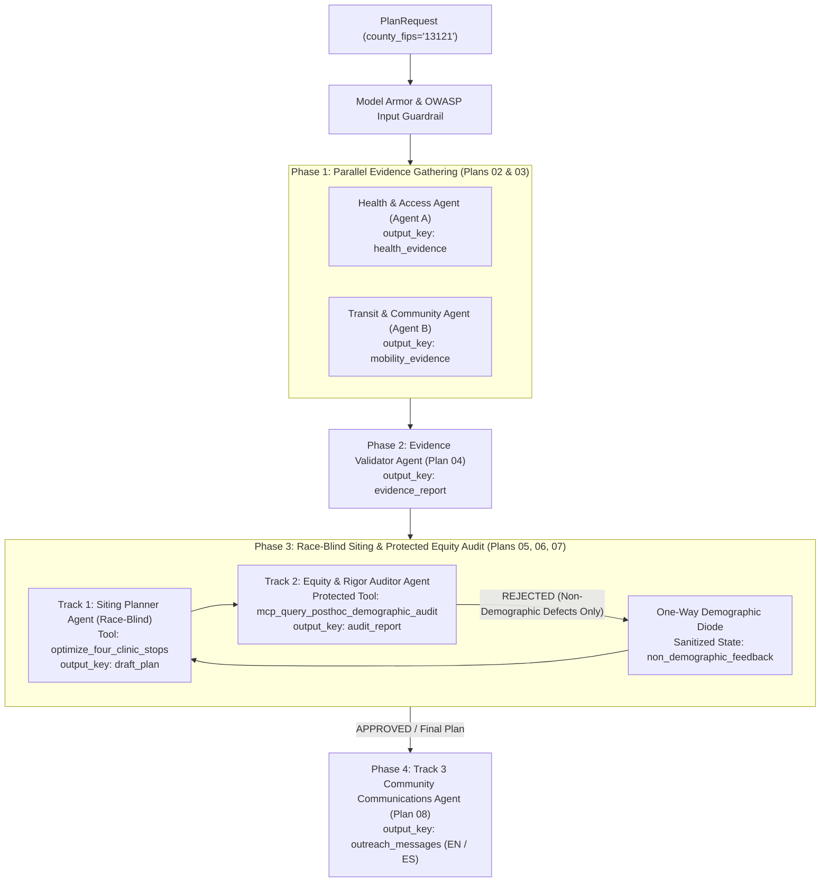

# CareBridge

Plans four Saturday mobile clinic stops for a county from public federal data, audits the plan for
who it lands on, and explains it to the neighborhood. Built for Agents for Impact 2026, Challenge 5.

| Folder | Component | What it is |
|---|---|---|
| [`ui/`](ui/README.md) | `ui` | Saturday Planner, a Flutter app (web, iOS, Android) |
| [`api/`](api/README.md) | `api` | FastAPI gateway between the UI and the agents |
| `agents/` | `agents` | ADK multi-agent graph (coming) |
| `mcp/` | `mcp` | Self-hosted MCP Toolbox, only if needed (coming) |
| [`deploy/`](deploy/README.md) | | Component registry and Cloud Run templates; **start here for CI/CD** |
| `ci/` | | Generic Cloud Build configs and scripts |
| `infra/` | | Terraform for the Google Cloud setup |

Shared settings (`BQ_PROJECT`, `GOOGLE_CLOUD_PROJECT`, ...) go in a gitignored `.env` at the repo root.

---

## CareBridge Fulton — Mobile Preventive Health Siting & Equity Co-Pilot

CareBridge Fulton is a production-grade, multi-agent decision-support system built with the **Google Agent Development Kit (ADK)**, **Vertex AI Gemini 2.5**, and **BigQuery MCP**. It helps the **Fulton County (`13121`) Department of Public Health** site **four Saturday mobile preventive health clinic stops** while enforcing a structural **One-Way Demographic Diode** between race-blind clinical/access siting (Track 1), independent post-hoc equity auditing (Track 2), and bilingual community outreach (Track 3).

---

## Architectural Highlights



### Core Engineering Guarantees

1. **Three-Track Separation & One-Way Demographic Diode**:
   - **Track 1 (Advisor — Race-Blind Siting)**: Uses only clinical, preventive care gap (`100 - pct_checkup`), insurance gap, vehicle access, physical distance to care/safety-net clinics, air-quality tail exposure, and Saturday transit proximity. Strictly blocked from seeing `rpl_theme3`, `rpl_themes`, race/ethnicity percentages, or `external_demographic_audit`.
   - **Track 2 (Auditor — Protected Post-Hoc Equity & Methodological Gate)**: Holds exclusive access to `external_demographic_audit.tract_demographics_audit` to compute post-hoc distributional equity comparisons and inspects plans for non-demographic methodological defects. Only sanitized `NonDemographicAuditDefect` items may cross the diode back to the Planner.
   - **Track 3 (Community Explanation — Bilingual Outreach)**: Translates the audited final plan into plain-language English and Spanish outreach notices for selected stops (`#1`–`#4`) and transparent counterfactual explanations for high-need runner-up neighborhoods (`#5`–`#8`, Question 7).
2. **Explicit Multi-Resolution Spatial Grain Enforcement**:
   - Prevents ecological fallacies across 5 distinct spatial grains: `census_tract_11char`, `epa_12km_grid_on_tract_id` (`cma_aq`), `facility_lon_lat_point` (`care_sites`), `hrsa_mixed_grain_component` (`shortage_areas`), and `multi_county_health_service_area` (`disease_weekly` across Fulton, DeKalb, Clayton, and Gwinnett).
3. **Provisional Host Honesty**:
   - All candidate host venues (IMLS public libraries, community centers, and transit-adjacent plazas) carry `host_permission_verified = False` and explicit provisional disclaimers in both English and Spanish.

---

## Completed Implementation Plans (`Plan 00` – `Plan 08`)

| Plan | Component / Module | Status | Documentation |
| :--- | :--- | :--- | :--- |
| **Plan 00** | Shared Contracts, Security Guardrails, Telemetry & Fulton Fixtures | Completed | [`carebridge/contracts/README.md`](file:///Users/dvt112/Downloads/A4I/carebridge/contracts/README.md), [`carebridge/security/README.md`](file:///Users/dvt112/Downloads/A4I/carebridge/security/README.md), [`carebridge/telemetry/README.md`](file:///Users/dvt112/Downloads/A4I/carebridge/telemetry/README.md), [`carebridge/mocks/README.md`](file:///Users/dvt112/Downloads/A4I/carebridge/mocks/README.md) |
| **Plan 01** | BigQuery Data Plane, SQL Views & MCP Toolset Boundary | Completed | [`carebridge/data_plane/README.md`](file:///Users/dvt112/Downloads/A4I/carebridge/data_plane/README.md), [`carebridge/data_plane/sql/README.md`](file:///Users/dvt112/Downloads/A4I/carebridge/data_plane/sql/README.md) |
| **Plan 02** | Health & Access Evidence Agent (Agent A · MCP) | Completed | [`carebridge/agents/health_agent/README.md`](file:///Users/dvt112/Downloads/A4I/carebridge/agents/health_agent/README.md) |
| **Plan 03** | Transit & Community Evidence Agent (Agent B · Optional Enrichments) | Completed | [`carebridge/agents/mobility_agent/README.md`](file:///Users/dvt112/Downloads/A4I/carebridge/agents/mobility_agent/README.md) |
| **Plan 04** | Evidence Validator Agent (Sequential Data-Quality Gate) | Completed | [`carebridge/agents/validator_agent/README.md`](file:///Users/dvt112/Downloads/A4I/carebridge/agents/validator_agent/README.md) |
| **Plan 05** | Four-Stop Coverage Optimizer Tool (Deterministic Spatial Math) | Completed | [`carebridge/tools/optimizer/README.md`](file:///Users/dvt112/Downloads/A4I/carebridge/tools/optimizer/README.md) |
| **Plan 06** | Siting Planner Agent (Track 1 Race-Blind Inputs) | Completed | [`carebridge/agents/planner_agent/README.md`](file:///Users/dvt112/Downloads/A4I/carebridge/agents/planner_agent/README.md) |
| **Plan 07** | Independent Equity & Rigor Auditor Agent (Track 2 Protected Boundary) | Completed | [`carebridge/agents/auditor_agent/README.md`](file:///Users/dvt112/Downloads/A4I/carebridge/agents/auditor_agent/README.md) |
| **Plan 08** | Community Communications Agent (Track 3 Bilingual EN/ES) | Completed | [`carebridge/agents/communicator_agent/README.md`](file:///Users/dvt112/Downloads/A4I/carebridge/agents/communicator_agent/README.md) |
| *Plan 09* | *Root Orchestrator (`ParallelAgent` + `LoopAgent` + `SequentialAgent`)* | *Planned* | [`plans/plan_09_orchestrator_workflow.md`](file:///Users/dvt112/Downloads/A4I/plans/plan_09_orchestrator_workflow.md) |
| *Plan 10* | *FastAPI Service & Interactive Equity Co-Pilot UI* | *Planned* | [`plans/plan_10_api_and_ui_dashboard.md`](file:///Users/dvt112/Downloads/A4I/plans/plan_10_api_and_ui_dashboard.md) |
| *Plan 11* | *CI/CD, End-to-End Evaluation Suite & Cloud Run Deployment* | *Planned* | [`plans/plan_11_eval_cicd_and_cloud_run.md`](file:///Users/dvt112/Downloads/A4I/plans/plan_11_eval_cicd_and_cloud_run.md) |

---

## Repository Structure

```text
A4I/
├── README.md                          # Project overview & documentation index
├── plans/                             # Architectural master index & 12 modular plans
│   └── README.md
├── carebridge/                        # Core Python package
│   ├── README.md                      # Package configuration & module overview
│   ├── config.py                      # Environment-driven Settings (Pydantic)
│   ├── _compat.py                     # Offline-resilient Pydantic & GenAI shims
│   ├── contracts/                     # Plan 00: Strict Pydantic schemas & state keys
│   ├── security/                      # Plan 00: Race-blind guard, Model Armor, OWASP callbacks
│   ├── telemetry/                     # Plan 00: OpenTelemetry spans & ADK telemetry plugin
│   ├── mocks/                         # Plan 00: Fulton County (13121) 12-tract fixtures
│   ├── data_plane/                    # Plan 01: BigQuery MCP bridge, validators & SQL views
│   │   └── sql/                       # Plan 01: MARTA GTFS, enrichments & demographic audit SQL
│   ├── tools/                         # Deterministic ADK tools package
│   │   └── optimizer/                 # Plan 05: 4-stop spatial coverage optimizer & sensitivity
│   └── agents/                        # ADK multi-agent definitions (Plans 02, 03, 04, 06, 07, 08)
│       ├── health_agent/              # Plan 02: Evidence Agent A (Health & Access)
│       ├── mobility_agent/            # Plan 03: Evidence Agent B (Transit & Community)
│       ├── validator_agent/           # Plan 04: Sequential Data-Quality Gate
│       ├── planner_agent/             # Plan 06: Track 1 Race-Blind Siting Planner
│       ├── auditor_agent/             # Plan 07: Track 2 Independent Equity & Rigor Auditor
│       └── communicator_agent/        # Plan 08: Track 3 Bilingual Community Communicator
└── tests/                             # Certification test suite (test_00 through test_08)
    └── README.md
```

---

## Quickstart & Running Tests

Run the full certification test suite for Plans `00` through `08`:

```bash
pytest -v
```

Or run individual plan certification suites with `unittest` or `pytest`:

```bash
pytest tests/test_00_contracts_and_security.py \
       tests/test_01_bigquery_mcp.py \
       tests/test_02_health_agent.py \
       tests/test_03_mobility_agent.py \
       tests/test_04_validator_agent.py \
       tests/test_05_optimizer_tool.py \
       tests/test_06_planner_agent.py \
       tests/test_07_auditor_agent.py \
       tests/test_08_communicator_agent.py -v
```

See [`tests/README.md`](file:///Users/dvt112/Downloads/A4I/tests/README.md) for detailed test coverage documentation.
