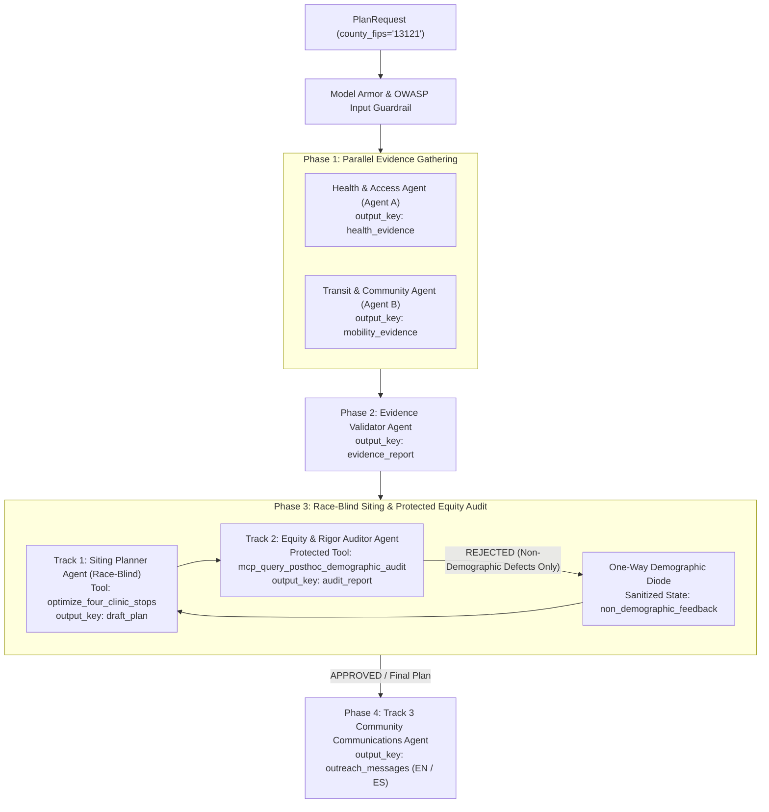

# CareBridge

Plans four Saturday mobile clinic stops for a county from public federal data, audits the plan for
who it lands on, and explains it to the neighborhood. Built for Agents for Impact 2026, Challenge 5.

| Folder | Component | What it is |
|---|---|---|
| [`ui/`](ui/README.md) | `ui` | Saturday Planner, a Flutter app (web, iOS, Android) |
| [`api/`](api/README.md) | `api` | FastAPI gateway between the UI and the agents |
| `agents/` | `agents` | ADK multi-agent graph (coming) |
| `mcp/` | `mcp` | Self-hosted MCP Toolbox, only if needed (coming) |
| [`deploy/`](deploy/README.md) | | Component registry and Cloud Run templates; **start here for CI/CD** |
| `ci/` | | Generic Cloud Build configs and scripts |
| `infra/` | | Terraform for the Google Cloud setup |

Shared settings (`BQ_PROJECT`, `GOOGLE_CLOUD_PROJECT`, ...) go in a gitignored `.env` at the repo root.

---

## CareBridge Fulton — Mobile Preventive Health Siting & Equity Co-Pilot

CareBridge Fulton is a production-grade, multi-agent decision-support system built with the **Google Agent Development Kit (ADK)**, **Vertex AI Gemini 2.5**, and **BigQuery MCP**. It helps the **Fulton County (`13121`) Department of Public Health** site **four Saturday mobile preventive health clinic stops** while enforcing a structural **One-Way Demographic Diode** between race-blind clinical/access siting (Track 1), independent post-hoc equity auditing (Track 2), and bilingual community outreach (Track 3).

---

## Architectural Highlights



### Core Engineering Guarantees

1. **Three-Track Separation & One-Way Demographic Diode**:
   - **Track 1 (Advisor — Race-Blind Siting)**: Uses only clinical, preventive care gap (`100 - pct_checkup`), insurance gap, vehicle access, physical distance to care/safety-net clinics, air-quality tail exposure, and Saturday transit proximity. Strictly blocked from seeing `rpl_theme3`, `rpl_themes`, race/ethnicity percentages, or `external_demographic_audit`.
   - **Track 2 (Auditor — Protected Post-Hoc Equity & Methodological Gate)**: Holds exclusive access to `external_demographic_audit.tract_demographics_audit` to compute post-hoc distributional equity comparisons and inspects plans for non-demographic methodological defects. Only sanitized `NonDemographicAuditDefect` items may cross the diode back to the Planner.
   - **Track 3 (Community Explanation — Bilingual Outreach)**: Translates the audited final plan into plain-language English and Spanish outreach notices for selected stops (`#1`–`#4`) and transparent counterfactual explanations for high-need runner-up neighborhoods (`#5`–`#8`, Question 7).
2. **Explicit Multi-Resolution Spatial Grain Enforcement**:
   - Prevents ecological fallacies across 5 distinct spatial grains: `census_tract_11char`, `epa_12km_grid_on_tract_id` (`cma_aq`), `facility_lon_lat_point` (`care_sites`), `hrsa_mixed_grain_component` (`shortage_areas`), and `multi_county_health_service_area` (`disease_weekly` across Fulton, DeKalb, Clayton, and Gwinnett).
3. **Provisional Host Honesty**:
   - All candidate host venues (IMLS public libraries, community centers, and transit-adjacent plazas) carry `host_permission_verified = False` and explicit provisional disclaimers in both English and Spanish.

---

## Component & Module Documentation Index

| Component / Module | Description | Documentation |
| :--- | :--- | :--- |
| **Core Package** | Configuration settings, environment bindings, and compatibility shims | [`carebridge/README.md`](file:///Users/dvt112/Downloads/A4I/carebridge/README.md) |
| **Contracts & State Keys** | Typed Pydantic schemas and ADK `session.state` visibility boundaries | [`carebridge/contracts/README.md`](file:///Users/dvt112/Downloads/A4I/carebridge/contracts/README.md) |
| **Security & Guardrails** | Race-blind Planner guards, PII checks, Model Armor, and OWASP callbacks | [`carebridge/security/README.md`](file:///Users/dvt112/Downloads/A4I/carebridge/security/README.md) |
| **Telemetry & Logging** | OpenTelemetry span instrumentation, structured Cloud Logging, and ADK plugin | [`carebridge/telemetry/README.md`](file:///Users/dvt112/Downloads/A4I/carebridge/telemetry/README.md) |
| **Fulton County Fixtures** | Realistic 12-tract Fulton County (`13121`) offline fixtures and builders | [`carebridge/mocks/README.md`](file:///Users/dvt112/Downloads/A4I/carebridge/mocks/README.md) |
| **BigQuery MCP Data Plane** | Read-only MCP bridge, 100 MB billing cap, toolset isolation, and SQL views | [`carebridge/data_plane/README.md`](file:///Users/dvt112/Downloads/A4I/carebridge/data_plane/README.md), [`carebridge/data_plane/sql/README.md`](file:///Users/dvt112/Downloads/A4I/carebridge/data_plane/sql/README.md) |
| **4-Stop Coverage Optimizer** | Deterministic Haversine spatial coverage, runner-up explanations, and sensitivity | [`carebridge/tools/README.md`](file:///Users/dvt112/Downloads/A4I/carebridge/tools/README.md), [`carebridge/tools/optimizer/README.md`](file:///Users/dvt112/Downloads/A4I/carebridge/tools/optimizer/README.md) |
| **Multi-Agent System** | Overview of all ADK agents across Tracks 1, 2, and 3 | [`carebridge/agents/README.md`](file:///Users/dvt112/Downloads/A4I/carebridge/agents/README.md) |
| **Health & Access Agent** | Evidence Agent A (`health_access_agent`) — tract burden, care sites, HSA & AQ | [`carebridge/agents/health_agent/README.md`](file:///Users/dvt112/Downloads/A4I/carebridge/agents/health_agent/README.md) |
| **Transit & Community Agent** | Evidence Agent B (`transit_community_agent`) — MARTA GTFS, food access & venues | [`carebridge/agents/mobility_agent/README.md`](file:///Users/dvt112/Downloads/A4I/carebridge/agents/mobility_agent/README.md) |
| **Evidence Validator Agent** | Sequential Data-Quality Gate (`evidence_validator_agent`) — `check()` vs `note()` | [`carebridge/agents/validator_agent/README.md`](file:///Users/dvt112/Downloads/A4I/carebridge/agents/validator_agent/README.md) |
| **Siting Planner Agent** | Track 1 Race-Blind Siting Advisor (`siting_planner_agent`) | [`carebridge/agents/planner_agent/README.md`](file:///Users/dvt112/Downloads/A4I/carebridge/agents/planner_agent/README.md) |
| **Equity & Rigor Auditor Agent** | Track 2 Protected Post-Hoc Auditor (`equity_rigor_auditor`) & Demographic Diode | [`carebridge/agents/auditor_agent/README.md`](file:///Users/dvt112/Downloads/A4I/carebridge/agents/auditor_agent/README.md) |
| **Community Communicator Agent** | Track 3 Bilingual (EN/ES) Outreach Agent (`community_communications_agent`) | [`carebridge/agents/communicator_agent/README.md`](file:///Users/dvt112/Downloads/A4I/carebridge/agents/communicator_agent/README.md) |
| **Test Suite** | Unit and end-to-end certification tests | [`tests/README.md`](file:///Users/dvt112/Downloads/A4I/tests/README.md) |

---

## Repository Structure

```text
A4I/
├── README.md                          # Project overview & documentation index
├── carebridge/                        # Core Python package
│   ├── README.md                      # Package configuration & module overview
│   ├── config.py                      # Environment-driven Settings (Pydantic)
│   ├── _compat.py                     # Offline-resilient Pydantic & GenAI shims
│   ├── contracts/                     # Strict Pydantic schemas & state keys
│   ├── security/                      # Race-blind guard, Model Armor, OWASP callbacks
│   ├── telemetry/                     # OpenTelemetry spans & ADK telemetry plugin
│   ├── mocks/                         # Fulton County (13121) 12-tract fixtures
│   ├── data_plane/                    # BigQuery MCP bridge, validators & SQL views
│   │   └── sql/                       # MARTA GTFS, enrichments & demographic audit SQL
│   ├── tools/                         # Deterministic ADK tools package
│   │   └── optimizer/                 # 4-stop spatial coverage optimizer & sensitivity
│   └── agents/                        # ADK multi-agent definitions
│       ├── health_agent/              # Evidence Agent A (Health & Access)
│       ├── mobility_agent/            # Evidence Agent B (Transit & Community)
│       ├── validator_agent/           # Sequential Data-Quality Gate
│       ├── planner_agent/             # Track 1 Race-Blind Siting Planner
│       ├── auditor_agent/             # Track 2 Independent Equity & Rigor Auditor
│       └── communicator_agent/        # Track 3 Bilingual Community Communicator
└── tests/                             # Certification & unit test suite
    └── README.md
```

---

## Quickstart & Running Tests

Run the full test suite via `unittest` or `pytest`:

```bash
python3 -m unittest discover -s tests -p "test_*.py" -v
```

See [`tests/README.md`](file:///Users/dvt112/Downloads/A4I/tests/README.md) for detailed test coverage documentation.
