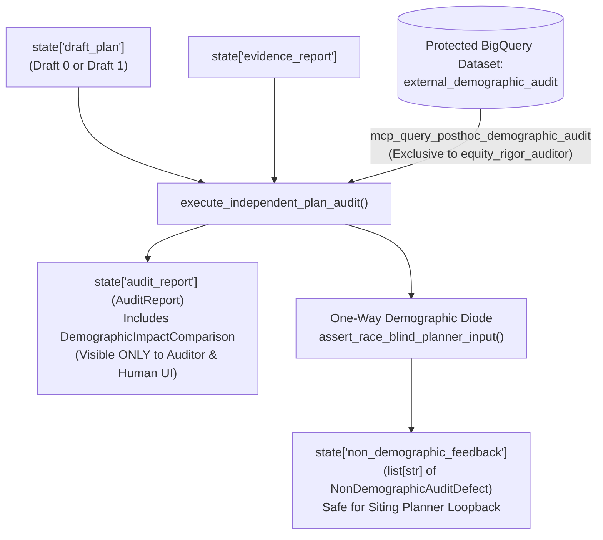

# `carebridge.agents.auditor_agent` — Independent Equity & Rigor Auditor Agent

The [`carebridge/agents/auditor_agent/`](file:///Users/dvt112/Downloads/A4I/carebridge/agents/auditor_agent/__init__.py) package implements **Track 2: The Independent Equity & Rigor Auditor Agent (`equity_rigor_auditor`)**, which enforces CareBridge Fulton's methodological quality gate, executes the post-hoc distributional equity audit, and maintains the **One-Way Demographic Diode**.

---

## The One-Way Demographic Diode Architecture



---

## Non-Demographic Methodological Checks

Implemented in [`_inspect_non_demographic_defects()`](file:///Users/dvt112/Downloads/A4I/carebridge/agents/auditor_agent/agent.py#L63-L234):

1. **Catchment Overlap (`DefectCategory.CATCHMENT_OVERLAP`)**:
   - Flags any pair of stops with Haversine distance `< 5.0 km` or shared covered tracts `> 20%`.
2. **Missing Evidence Citations (`DefectCategory.MISSING_EVIDENCE_CITATION`)**:
   - Flags any stop missing `evidence_citations` or missing a `13121...` tract GEOID reference, or missing Question 7 `runner_up_tracts`.
3. **Spatial Grain Misinterpretation (`DefectCategory.SPATIAL_GRAIN_MISINTERPRETATION`)**:
   - Scans all stop rationales and citations for:
     - `disease_weekly` cited without mentioning `"4-county"` or `"Health Service Area"` (`HSA`).
     - `mean_pm25` cited as a tract-unique measurement without acknowledging the `12 km` grid or `pm25_days_over_20`.
     - MARTA GTFS cited as `"door-to-door travel time"` or `"rider journey time"` instead of `400 m` Saturday stop proximity.
4. **Unverified Host Claim (`DefectCategory.UNVERIFIED_HOST_CLAIM`)**:
   - Flags any stop where `host_verified == True`, `provisional_warning` lacks `"PROVISIONAL"` / `"UNVERIFIED"`, or text claims a venue is `"confirmed and booked"`.
5. **Sensitivity Instability (`DefectCategory.SENSITIVITY_INSTABILITY`)**:
   - Flags plans where `sensitivity.mean_jaccard_similarity < 0.50`.

---

## Protected Post-Hoc Demographic Impact Computation

Implemented in [`_compute_posthoc_demographic_impact()`](file:///Users/dvt112/Downloads/A4I/carebridge/agents/auditor_agent/agent.py#L237-L321):
- Calls `mcp_query_posthoc_demographic_audit(county_fips, caller_agent="equity_rigor_auditor")`.
- Computes population-weighted county baselines vs. 4-stop catchment served shares across `minority_overall`, `black_african_american`, and `hispanic_latino`.
- Computes `high_svi_theme3_tracts_served_ratio` (proportion of county tracts with `rpl_theme3 >= 0.75` covered by the 4 catchments).
- **Crucial Policy Rule**: Post-hoc demographic findings are recorded in `AuditReport.demographic_impact` for human policy review and **never** generate revision instructions for the Planner.

---

## Verdict Logic & Escalation (`max_audit_revisions = 1`)

- **`AuditVerdict.APPROVED`**: `len(non_demographic_defects) == 0` and `plan.status == "ok"`. Sets `state["revision_required"] = False` and promotes `state["final_plan"] = draft_plan`.
- **`AuditVerdict.REJECTED_REVISION_REQUIRED`**: `len(non_demographic_defects) > 0` on `revision_audited < max_audit_revisions` (`Draft 0`). Sets `state["revision_required"] = True` and writes sanitized `remediation_instruction` strings to `state["non_demographic_feedback"]` (verified by `assert_race_blind_planner_input()`).
- **`AuditVerdict.NEEDS_HUMAN_REVIEW`**: If `core_tables_ready == False`, `plan.status != "ok"`, or defects remain when `revision_audited >= max_audit_revisions` (`Draft 1`). Sets `state["revision_required"] = False` to prevent infinite loops.

---

## Verification

Tested in [`tests/test_07_auditor_agent.py`](file:///Users/dvt112/Downloads/A4I/tests/test_07_auditor_agent.py):
```bash
python3 -m unittest tests/test_07_auditor_agent.py -v
```
