# `carebridge.agents.health_agent` — Health & Access Evidence Agent

The [`carebridge/agents/health_agent/`](file:///Users/dvt112/Downloads/A4I/carebridge/agents/health_agent/__init__.py) package implements **Evidence Agent A (`health_access_agent`)**, which runs as Branch A of the parallel evidence-gathering phase to retrieve race-blind tract burden, care access distances, HRSA facility/area shortages, 4-county HSA respiratory surveillance, and EPA 12 km grid PM2.5 exposure tail data.

---

## Responsibilities & Data Flow

```mermaid
flowchart LR
    StateIn["state['plan_request']<br/>(county_fips='13121')"] --> Tool["fetch_county_health_evidence()"]
    subgraph MCP ["BigQueryMCPBridge (evidence_toolset)"]
        Q1["mcp_query_tract_burden_and_access"]
        Q2["mcp_query_care_sites_and_shortages"]
        Q3["mcp_query_regional_disease_weekly"]
        Q4["mcp_query_air_exposure_tail"]
    end
    Tool --> MCP
    MCP --> Guards["assert_race_blind_planner_input()<br/>+ assert_no_pii_in_payload()"]
    Guards --> StateOut["state['health_evidence']<br/>(HealthEvidence)"]
```



---

## Key Files

### 1. [`prompt.py`](file:///Users/dvt112/Downloads/A4I/carebridge/agents/health_agent/prompt.py)
Defines [`HEALTH_AGENT_INSTRUCTION`](file:///Users/dvt112/Downloads/A4I/carebridge/agents/health_agent/prompt.py#L6-L56), which instructs the agent to:
- Read `{plan_request?}` from `session.state` and call `fetch_county_health_evidence(county_fips=...)`.
- Enforce the 5 core domain rules:
  1. **Race-Blind & PII-Free Boundary**: Never select or infer `rpl_theme3`, `rpl_themes`, race/ethnicity percentages, or HRSA administrative contact PII (`fqhc_admin_contact_*`).
  2. **Preventive Care Checkup Inversion**: Invert `pct_checkup` ("attended a routine checkup") into `pct_checkup_gap = round(100.0 - pct_checkup, 2)` so higher values consistently mean higher unmet preventive need.
  3. **HPSA Shortage Area vs. Shortage Facility Nuance**: Explicitly distinguish geographic HPSA polygons (`shortage_areas_count == 0` in Fulton) from designated safety-net shortage facilities (`shortage_facilities_count == 6`, max HPSA score `19.0`) and `care_sites` (`85` sites, `41` safety-net sites).
  4. **Multi-County Health Service Area (`disease_weekly`) Grain**: Label CDC NSSP ED visits (`percent_visits_covid`, `percent_visits_influenza`, `percent_visits_rsv`) as `SpatialGrain.MULTI_COUNTY_HSA` covering **Fulton, DeKalb, Clayton, and Gwinnett**, and set `data_unavailable = True` without fabricating zeros if weekly values are `NULL`.
  5. **12 km Grid Air Exposure (`cma_aq`) Grain**: Attach `mean_pm25_12km_caveat` and use `pm25_days_over_20` as the tract-differentiating respiratory exposure signal.

### 2. [`agent.py`](file:///Users/dvt112/Downloads/A4I/carebridge/agents/health_agent/agent.py)
- **[`fetch_county_health_evidence(county_fips="13121", tool_context=None, mcp_bridge=None)`](file:///Users/dvt112/Downloads/A4I/carebridge/agents/health_agent/agent.py#L45-L185)**:
  - Executes the 4 read-only MCP queries (`mcp_query_tract_burden_and_access`, `mcp_query_care_sites_and_shortages`, `mcp_query_regional_disease_weekly`, `mcp_query_air_exposure_tail`).
  - Merges `pm25_days_over_20` by 11-character `geo_id`, normalizes `pct_checkup_gap`, detects `NULL` NSSP trajectories (`data_unavailable = True`), and constructs a validated [`HealthEvidence`](file:///Users/dvt112/Downloads/A4I/carebridge/contracts/evidence_models.py#L128-L157) instance.
  - Verifies the output with `assert_no_pii_in_payload()` and `assert_race_blind_planner_input()` before writing exclusively to `state["health_evidence"]`.
  - Emits the `agent.health_access.fetch_evidence` OpenTelemetry span and `health_evidence_fetched` structured log.
- **[`build_health_access_agent(mcp_bridge=None, model=None)`](file:///Users/dvt112/Downloads/A4I/carebridge/agents/health_agent/agent.py#L188-L216)**:
  - Builds the Google ADK `LlmAgent` (`name="health_access_agent"`, `output_key="health_evidence"`, `output_schema=HealthEvidence`) wired with `before_model_guardrail_callback`, `after_model_guardrail_callback`, `before_tool_guardrail_callback`, and `after_tool_race_and_pii_callback`.

---

## Verification

Tested in [`tests/test_02_health_agent.py`](file:///Users/dvt112/Downloads/A4I/tests/test_02_health_agent.py):
```bash
python3 -m unittest tests/test_02_health_agent.py -v
```
