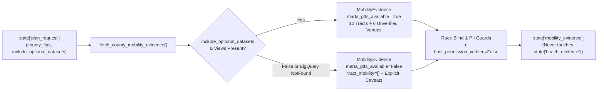

# `carebridge.agents.mobility_agent` — Transit & Community Evidence Agent

The [`carebridge/agents/mobility_agent/`](file:///Users/dvt112/Downloads/A4I/carebridge/agents/mobility_agent/__init__.py) package implements **Evidence Agent B (`transit_community_agent`)**, which runs in parallel with `health_access_agent` to gather Saturday MARTA GTFS stop proximity (`08:00–18:00`), USDA Food Access Research Atlas indicators, and IMLS public library / community center candidate host venues.

---

## Responsibilities & Graceful Degradation Flow



---

## Key Files

### 1. [`prompt.py`](file:///Users/dvt112/Downloads/A4I/carebridge/agents/mobility_agent/prompt.py)
Defines [`MOBILITY_AGENT_INSTRUCTION`](file:///Users/dvt112/Downloads/A4I/carebridge/agents/mobility_agent/prompt.py#L22-L67) and two mandatory constants:
- **[`MANDATORY_STOP_PROXIMITY_CAVEAT`](file:///Users/dvt112/Downloads/A4I/carebridge/agents/mobility_agent/prompt.py#L6-L12)**:
  `"MARTA GTFS metrics measure Saturday stop proximity within 400m and scheduled trip events (08:00-18:00), NOT full origin-to-destination rider travel time or routing durations."`
- **[`CC_BY_NC_TRANSIT_CAVEAT`](file:///Users/dvt112/Downloads/A4I/carebridge/agents/mobility_agent/prompt.py#L14-L19)**:
  `"Transit access database is skipped due to CC-BY-NC non-commercial licensing restrictions; Saturday transit proximity is derived directly from MARTA GTFS static schedule feeds."`

### 2. [`agent.py`](file:///Users/dvt112/Downloads/A4I/carebridge/agents/mobility_agent/agent.py)
- **[`fetch_county_mobility_evidence(county_fips="13121", include_optional_datasets=True, tool_context=None, mcp_client=None)`](file:///Users/dvt112/Downloads/A4I/carebridge/agents/mobility_agent/agent.py#L66-L197)**:
  - Checks both the `include_optional_datasets` parameter and `state["plan_request"]["include_optional_datasets"]`.
  - When disabled or when BigQuery raises `NotFound` / `BigQueryNotFoundError`, gracefully returns a valid [`MobilityEvidence`](file:///Users/dvt112/Downloads/A4I/carebridge/contracts/evidence_models.py#L205-L227) object with `marta_gtfs_available=False`, `usda_food_access_available=False`, `imls_venues_available=False`, and explanatory caveats so the pipeline continues using core tables only.
  - Forces `host_permission_verified = False` on every [`CandidateHostVenue`](file:///Users/dvt112/Downloads/A4I/carebridge/contracts/evidence_models.py#L160-L176) via `enforce_unverified_host_venues()`.
  - Verifies race-blind and PII guards and writes strictly to `state["mobility_evidence"]` without touching `state["health_evidence"]`.
  - Emits the `agent.mobility.fetch_county_mobility_evidence` OpenTelemetry span.
- **[`build_transit_community_agent(model=None, mcp_client=None)`](file:///Users/dvt112/Downloads/A4I/carebridge/agents/mobility_agent/agent.py#L200-L238)**:
  - Builds the Google ADK `LlmAgent` (`name="transit_community_agent"`, `output_key="mobility_evidence"`, `output_schema=MobilityEvidence`) wired with all OWASP and race-blind callbacks.

---

## Verification

Tested in [`tests/test_03_mobility_agent.py`](file:///Users/dvt112/Downloads/A4I/tests/test_03_mobility_agent.py):
```bash
python3 -m unittest tests/test_03_mobility_agent.py -v
```
