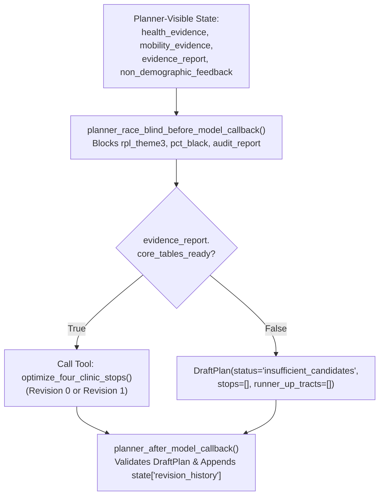

# `carebridge.agents.planner_agent` — Siting Planner Agent

The [`carebridge/agents/planner_agent/`](file:///Users/dvt112/Downloads/A4I/carebridge/agents/planner_agent/__init__.py) package implements **Track 1: The Siting Planner Agent (`siting_planner_agent`)**, which acts as the race-blind public health siting advisor inside `PlanAndAuditLoop`.

---

## Race-Blind Planning & Revision Loop Architecture



---

## Key Files & Callbacks

### 1. [`prompt.py`](file:///Users/dvt112/Downloads/A4I/carebridge/agents/planner_agent/prompt.py)
Defines [`PLANNER_AGENT_INSTRUCTION`](file:///Users/dvt112/Downloads/A4I/carebridge/agents/planner_agent/prompt.py#L6-L70):
- **Scoped Template Placeholders**: References only `{plan_request?}`, `{health_evidence?}`, `{mobility_evidence?}`, `{evidence_report?}`, and `{non_demographic_feedback?}`. **Never references `{audit_report?}`**.
- **6 Non-Negotiable Siting Rules**:
  1. **Strict Race-Blind Siting**: Never infer or optimize on SVI Theme 3 (`rpl_theme3`), overall SVI (`rpl_themes`), or race/ethnicity variables.
  2. **Deterministic Tool Invocation**: Never perform mental arithmetic; always call `optimize_four_clinic_stops`.
  3. **Core Readiness Gate**: If `evidence_report.core_tables_ready == False`, immediately emit `DraftPlan(status="insufficient_candidates")` without fabricating stops.
  4. **Provisional Host Venues**: Keep `host_verified = False` and include the `provisional_warning` banner on all 4 stops.
  5. **Spatial Grain Honesty**: Cite `disease_weekly` strictly as a 4-county Health Service Area signal (`Fulton, DeKalb, Clayton, Gwinnett`), `cma_aq` as a 12 km grid with `pm25_days_over_20` tail metrics, and MARTA GTFS as 400 m stop proximity.
  6. **Counterfactual Runner-Up Transparency (Question 7)**: Explain why high-need runner-up tracts (`#5`–`#8`) were not selected as primary anchors and which of the 4 stops covers or lies nearest to them.

### 2. [`agent.py`](file:///Users/dvt112/Downloads/A4I/carebridge/agents/planner_agent/agent.py)
- **[`planner_race_blind_before_model_callback(callback_context, llm_request)`](file:///Users/dvt112/Downloads/A4I/carebridge/agents/planner_agent/agent.py#L51-L115)**:
  - Runs `before_model_guardrail_callback` (Model Armor + OWASP checks).
  - Scans outgoing prompt text for forbidden references (`audit_report`, `demographic_impact`, `external_demographic_audit`, `rpl_theme3`, `pct_black`, `pct_hispanic`, `pct_minority`).
  - Recursively validates all Planner-visible `session.state` keys (`health_evidence`, `mobility_evidence`, `evidence_report`, `non_demographic_feedback`, `plan_request`) with `assert_race_blind_planner_input()` and `assert_no_pii_in_payload()`.
- **[`planner_after_model_callback(callback_context, llm_response)`](file:///Users/dvt112/Downloads/A4I/carebridge/agents/planner_agent/agent.py#L118-L163)**:
  - Runs `after_model_guardrail_callback` and `assert_race_blind_planner_input()`.
  - Validates the output against [`DraftPlan`](file:///Users/dvt112/Downloads/A4I/carebridge/contracts/plan_models.py#L150-L185) and appends a serialized snapshot to `state["revision_history"]` (avoiding duplicate entries for the same `revision_number`).
- **[`SitingPlannerAgent`](file:///Users/dvt112/Downloads/A4I/carebridge/agents/planner_agent/agent.py#L183-L321)** & **[`build_siting_planner_agent()`](file:///Users/dvt112/Downloads/A4I/carebridge/agents/planner_agent/agent.py#L324-L347)**:
  - Google ADK `LlmAgent` (`name="siting_planner_agent"`, `model="gemini-2.5-pro"`, `output_key="draft_plan"`, `output_schema=DraftPlan`, `tools=[optimize_four_clinic_stops]`).
  - Automatically increments `revision_number` when `state["non_demographic_feedback"]` is non-empty (`Draft 0` $\rightarrow$ `Draft 1`), repairing any catchment overlap or grain overclaim defects identified by the Auditor.

---

## Verification

Tested in [`tests/test_06_planner_agent.py`](file:///Users/dvt112/Downloads/A4I/tests/test_06_planner_agent.py):
```bash
python3 -m unittest tests/test_06_planner_agent.py -v
```
