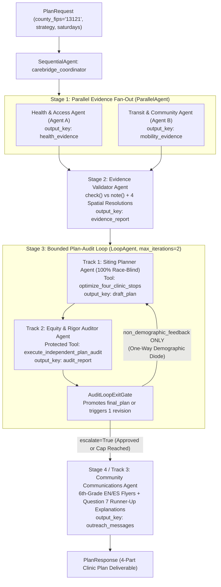

# CareBridge Fulton — End-to-End Testing & Challenge 5 Compliance Documentation

This directory ([`carebridge/docs/`](file:///Users/dvt112/Downloads/A4I/carebridge/docs/)) contains the complete end-to-end (E2E) test specification, requirement traceability matrix, multi-agent architectural guarantees, and local verification results for **CareBridge Fulton** against the **Agents for Impact (A4I) 2026 Challenge 5 — Public Health** specification (`https://github.com/haggman/A4I2026-challenge-5-public-health` and [`c5_01_load_explore.ipynb`](file:///Users/dvt112/Downloads/A4I/c5_01_load_explore.ipynb)).

---

## Documentation Index

| Document | Purpose & Scope |
| :--- | :--- |
| **[`challenge_5_test_cases.md`](file:///Users/dvt112/Downloads/A4I/carebridge/docs/challenge_5_test_cases.md)** | Full specification of all Challenge 5 test cases mapped to *"What you're building"*, *"Questions that need more than we gave you"*, *"Three Tracks, One Architecture"*, *"The four questions judges look for"*, and the 10 deliberate data exclusions. |
| **[`test_execution_tracker.md`](file:///Users/dvt112/Downloads/A4I/carebridge/docs/test_execution_tracker.md)** | Step-by-step E2E test execution tracker (`TC-01` through `TC-12`) recording execution status, timestamps, durations, and empirical test metrics. |
| **[`e2e_verification_report.md`](file:///Users/dvt112/Downloads/A4I/carebridge/docs/e2e_verification_report.md)** | Local end-to-end test execution report (**76 tests across 11 suites, 100% passing**), walkthrough of the 3 siting strategies, standard vs. adversarial revision trajectories (`Draft 0` $\rightarrow$ `Draft 1`), and graceful degradation results. |
| **[`multi_agent_architecture_guarantees.md`](file:///Users/dvt112/Downloads/A4I/carebridge/docs/multi_agent_architecture_guarantees.md)** | Reference on the 6-agent ADK topology (`ParallelAgent` $\rightarrow$ `Validator` $\rightarrow$ `LoopAgent(max_iterations=2)` $\rightarrow$ `Communicator`), the **One-Way Demographic Diode**, the 4 spatial resolutions, and formal answers to the 4 Judge Questions. |

---

## Quick Start: Running End-to-End Tests Locally

All unit, integration, and end-to-end Challenge 5 compliance tests run deterministically offline in under 3 seconds using Python's built-in `unittest` runner:

```bash
# Run the complete 76-test suite (Plans 00-09 + Plan 11 E2E Challenge 5 Compliance)
python3 -m unittest discover -s tests -p "test_*.py" -v

# Run only the Challenge 5 End-to-End Compliance Suite (12 comprehensive E2E scenarios)
python3 -m unittest tests/test_11_e2e_challenge_compliance.py -v

# Run the Coordinator Multi-Agent Workflow Suite (Plan 09)
python3 -m unittest tests/test_09_coordinator_workflow.py -v
```

---

## End-to-End Multi-Agent Architecture Overview


