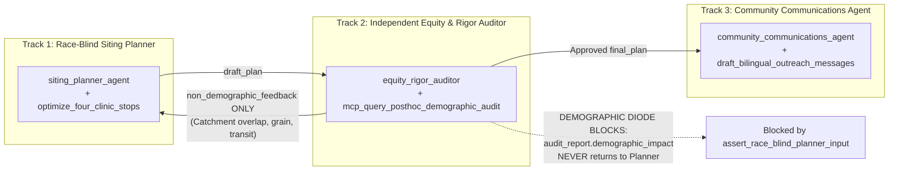

# CareBridge Fulton — Multi-Agent Architecture & Challenge 5 Guarantees

This document details how the CareBridge Fulton multi-agent architecture satisfies the structural, epistemic, and ethical requirements of **A4I 2026 Challenge 5 — Public Health** ([`c5_01_load_explore.ipynb`](file:///Users/dvt112/Downloads/A4I/c5_01_load_explore.ipynb)).

---

## 1. Three Tracks, One Architecture & The One-Way Demographic Diode

Public health siting faces a fundamental tension: **siting algorithms should allocate mobile clinics based on clinical, structural, and mobility need rather than racial targeting, yet public health leadership must audit the resulting plan post-hoc to ensure underserved minority communities are not left behind.**

CareBridge resolves this tension structurally through **Three Tracks** and a **One-Way Demographic Diode**:

1. **Physical Toolset Isolation ([`carebridge/data_plane/bq_mcp_client.py`](file:///Users/dvt112/Downloads/A4I/carebridge/data_plane/bq_mcp_client.py))**:
   - Evidence Agents A & B only receive `get_evidence_toolset()`, which queries race-blind BigQuery views (`v_burden_tracts`, `v_tract_access`, `v_care_sites`, `v_shortage_areas`, `v_exposure_tracts`, `v_disease_weekly`).
   - Only `equity_rigor_auditor` receives `get_audit_toolset()` containing `mcp_query_posthoc_demographic_audit` (`v_external_demographic_audit`), enforced at runtime by [`before_tool_guardrail_callback`](file:///Users/dvt112/Downloads/A4I/carebridge/security/owasp_guardrails.py#L75-L91).
2. **State-Key & Prompt Guardrails ([`carebridge/security/race_blind_guard.py`](file:///Users/dvt112/Downloads/A4I/carebridge/security/race_blind_guard.py))**:
   - [`planner_race_blind_before_model_callback`](file:///Users/dvt112/Downloads/A4I/carebridge/agents/planner_agent/agent.py#L315-L342) scans the Planner's outgoing prompt and all visible state keys (`PLANNER_VISIBLE_STATE_KEYS` + `SANITIZED_LOOPBACK_STATE_KEYS`) before every model call. Any appearance of `rpl_theme3`, `rpl_themes`, `ep_minrty`, `pct_black`, `pct_hispanic`, or `audit_report` raises `PolicyViolationError`.

---

## 2. The Four Questions Judges Look For

### Question 1: *"If I delete any one agent from your diagram, does the answer get worse?"*
**Yes — verified in [`test_03_judge_question_1_delete_any_agent_degrades_or_breaks_deliverable`](file:///Users/dvt112/Downloads/A4I/tests/test_11_e2e_challenge_compliance.py#L218-L282):**
- **Delete Agent A (`health_access_agent`)**: `state["health_evidence"]` has no validated tracts $\rightarrow$ `evidence_validator_agent` sets `core_tables_ready=False` $\rightarrow$ `siting_planner_agent` halts with `status="insufficient_candidates"`.
- **Delete Agent B (`transit_community_agent`)**: `state["mobility_evidence"]` loses Saturday MARTA GTFS headways, USDA low-access food desert flags, and IMLS public library candidate venues $\rightarrow$ optimizer degrades to raw census tract centroids with `saturday_transit_access_bonus = 0.0`.
- **Delete Validator (`evidence_validator_agent`)**: Pipeline loses fatal schema/GEOID/inversion checks (`check()`), non-fatal HPSA publisher warnings (`note()`), and mandatory 4-resolution spatial grain caveats.
- **Delete Auditor (`equity_rigor_auditor`)**: Overlapping stops ($< 5.0\text{ km}$) and ecological fallacy overclaims in `Draft 0` are never caught or repaired, and post-hoc demographic parity (`demographic_impact`) is never computed.
- **Delete Communicator (`community_communications_agent`)**: Outreach lead receives only technical analytical citations without 6th-grade English/Spanish bus-stop flyers or empathetic Question 7 runner-up explanations.

### Question 2: *"Show me a key in `session.state` that one agent writes and another agent reads."*
**Verified in [`test_04_judge_question_2_session_state_handoff_chain_across_all_agents`](file:///Users/dvt112/Downloads/A4I/tests/test_11_e2e_challenge_compliance.py#L284-L324):**

| `session.state` Key | Written By | Read By | Schema Contract |
| :--- | :--- | :--- | :--- |
| `health_evidence` | `health_access_agent` (Branch A) | `evidence_validator_agent`, `siting_planner_agent` | [`HealthEvidence`](file:///Users/dvt112/Downloads/A4I/carebridge/contracts/evidence_models.py#L92-L103) |
| `mobility_evidence` | `transit_community_agent` (Branch B) | `evidence_validator_agent`, `siting_planner_agent` | [`MobilityEvidence`](file:///Users/dvt112/Downloads/A4I/carebridge/contracts/evidence_models.py#L129-L139) |
| `evidence_report` | `evidence_validator_agent` | `siting_planner_agent`, `equity_rigor_auditor`, `community_communications_agent` | [`EvidenceReport`](file:///Users/dvt112/Downloads/A4I/carebridge/contracts/evidence_models.py#L149-L157) |
| `draft_plan` | `siting_planner_agent` | `equity_rigor_auditor`, `audit_loop_exit_gate` | [`DraftPlan`](file:///Users/dvt112/Downloads/A4I/carebridge/contracts/plan_models.py#L79-L90) |
| `non_demographic_feedback` | `equity_rigor_auditor` | `siting_planner_agent` (Iteration 1) | `List[NonDemographicAuditDefect]` |
| `audit_report` | `equity_rigor_auditor` | `audit_loop_exit_gate`, `PlanResponse` | [`AuditReport`](file:///Users/dvt112/Downloads/A4I/carebridge/contracts/audit_models.py#L50-L56) |
| `final_plan` | `audit_loop_exit_gate` | `community_communications_agent`, `PlanResponse` | [`DraftPlan`](file:///Users/dvt112/Downloads/A4I/carebridge/contracts/plan_models.py#L79-L90) |
| `outreach_messages` | `community_communications_agent` | `PlanResponse` | [`OutreachMessages`](file:///Users/dvt112/Downloads/A4I/carebridge/contracts/outreach_models.py#L42-L53) |

### Question 3: *"Show me two agents whose instructions genuinely conflict."*
**Verified in [`test_05_judge_question_3_genuinely_conflicting_agent_instructions`](file:///Users/dvt112/Downloads/A4I/tests/test_11_e2e_challenge_compliance.py#L326-L355):**
- **Siting Planner (`siting_planner_agent`) vs. Community Communicator (`community_communications_agent`)**:
  - The Planner is instructed to be **analytical, source-cited, and resolution-qualified** for the county outreach lead—explicitly citing `pct_uninsured_18_64` with `95% CI` width, `100 - pct_checkup` inversion, and Euclidean upper-bound caveats.
  - The Communicator is instructed to write **warm, 6th-grade reading level English and Spanish flyers** for bus stops and library bulletin boards—explicitly **prohibiting statistical hedging** (`95% CI`, `p90/p10`, `Jaccard`, `Haversine`).
- **Siting Planner (`siting_planner_agent`) vs. Equity & Rigor Auditor (`equity_rigor_auditor`)**:
  - The Planner is **generative and strictly race-blind**, optimizing 4 stops from structural health and mobility indicators.
  - The Auditor is **adversarial and demographic-aware**, attempting to falsify the Planner's claims (checking for $< 5.0\text{ km}$ catchment overlap and spatial grain overclaims) while evaluating post-hoc SVI Theme 3 and racial/ethnic parity.

### Question 4: *"Show me a point where the system rejected its own first answer."*
**Verified in [`test_06_judge_question_4_self_rejection_and_bounded_revision_draft0_to_draft1`](file:///Users/dvt112/Downloads/A4I/tests/test_11_e2e_challenge_compliance.py#L357-L386):**
- When `simulate_first_draft_defect=True`, `Draft 0` places Stop #1 (`13121010514`) and Stop #2 (`13121010305`) `3.72 km` apart.
- `equity_rigor_auditor` rejects `Draft 0` (`AuditVerdict.REJECTED_REVISION_REQUIRED`) with `DEFECT-OVERLAP-S1-S2` (`DefectCategory.CATCHMENT_OVERLAP`).
- `siting_planner_agent` consumes `non_demographic_feedback` on Iteration 1 and produces `Draft 1`, relocating Stop #2 so all 4 stops are $\ge 5.0\text{ km}$ apart, which `equity_rigor_auditor` then approves (`AuditVerdict.APPROVED`).

---

## 3. Four Spatial Resolutions & Ecological Fallacy Prevention

| Spatial Grain (`SpatialGrain`) | Source Views | Allowed Use | Prohibited Ecological Fallacy (Blocked by Validator & Auditor) |
| :--- | :--- | :--- | :--- |
| **`census_tract_11char`** | `v_burden_tracts`, `v_tract_access` | Ranking neighborhood chronic/preventive burden and straight-line distance to federal care | Treating modeled CDC PLACES prevalences as exact patient headcounts or ignoring overlapping 95% CIs (`< 1–2%` differences) |
| **`epa_12km_grid_on_tract_id`** | `v_exposure_tracts` | Contextualizing tail exceedance days (`pm25_days_over_20`, deduplicated from 2x raw publication, 2021 vintage) | Ranking individual census tracts by annual mean PM2.5 (`p90/p10 = 1.05x` across Fulton County) |
| **`facility_lon_lat_point`** | `v_care_sites`, `v_care_sites_state`, `v_shortage_facilities` | Measuring Euclidean upper-bound distance to federal FQHCs/hospitals and weekly operating hours (`TOT_OPER_HR_PER_WEEK`) | Treating Euclidean distance as bus travel time, or using 0-populated RHC `*_FTE_CT` decoy columns |
| **`multi_county_health_service_area`** | `v_disease_weekly` | Regional situational awareness across the 4-county Atlanta HSA (`Fulton, DeKalb, Clayton, Gwinnett`) | Claiming COVID-19, influenza, or RSV emergency visits are spiking in a single census tract, or claiming *"no increase"* when `data_unavailable=True` |
