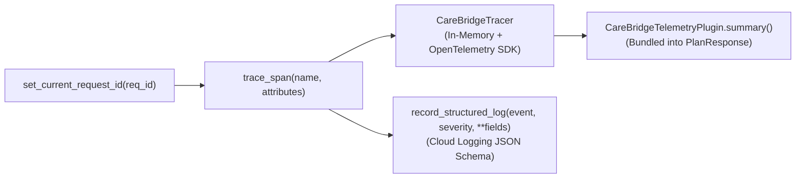

# `carebridge.telemetry` — OpenTelemetry Tracing & Structured Cloud Logging

The [`carebridge/telemetry/`](file:///Users/dvt112/Downloads/A4I/carebridge/telemetry/__init__.py) package provides OpenTelemetry span instrumentation, request correlation IDs, structured JSON Cloud Logging, and an ADK telemetry plugin for CareBridge Fulton.

---

## Architecture



---

## Modules

### 1. [`otel.py`](file:///Users/dvt112/Downloads/A4I/carebridge/telemetry/otel.py)
Provides deterministic in-memory span capture alongside optional OpenTelemetry SDK export:
- **[`set_current_request_id(request_id)`](file:///Users/dvt112/Downloads/A4I/carebridge/telemetry/otel.py#L22-L24)** & **[`get_current_request_id()`](file:///Users/dvt112/Downloads/A4I/carebridge/telemetry/otel.py#L27-L29)**: Manages the active `ContextVar` correlation ID (`request_id`) across async and synchronous agent calls.
- **[`RecordedSpan`](file:///Users/dvt112/Downloads/A4I/carebridge/telemetry/otel.py#L33-L45)**: Dataclass capturing `name`, `request_id`, `start_time_ms`, `end_time_ms`, `duration_ms`, `attributes`, and `status`.
- **[`CareBridgeTracer`](file:///Users/dvt112/Downloads/A4I/carebridge/telemetry/otel.py#L48-L67)** & **[`get_tracer()`](file:///Users/dvt112/Downloads/A4I/carebridge/telemetry/otel.py#L73-L75)**: Thread-safe singleton tracer that stores `recorded_spans` and `structured_logs` for certification assertions and `PlanResponse.telemetry_trace_summary`.
- **[`trace_span(name, attributes)`](file:///Users/dvt112/Downloads/A4I/carebridge/telemetry/otel.py#L79-L103)**: Context manager yielding a mutable `span_attrs` dictionary so tools and agents can attach dynamic metrics (e.g., `rows_returned`, `tract_count`, `verdict`, `mean_jaccard_similarity`) before the span closes.
- **[`record_structured_log(event, severity="INFO", **fields)`](file:///Users/dvt112/Downloads/A4I/carebridge/telemetry/otel.py#L106-L120)**: Emits a structured log entry containing `severity`, `event`, `request_id`, `timestamp_ms`, and custom key-value fields compatible with Google Cloud Logging.

### 2. [`adk_telemetry_plugin.py`](file:///Users/dvt112/Downloads/A4I/carebridge/telemetry/adk_telemetry_plugin.py)
Provides [`CareBridgeTelemetryPlugin`](file:///Users/dvt112/Downloads/A4I/carebridge/telemetry/adk_telemetry_plugin.py#L13-L61) for workflow-level observability:
- `record_agent_run(agent_name, revision=0, extra=None)`: Context manager wrapping an ADK agent execution in an `agent.run.<agent_name>` span and emitting `agent_run_completed` structured logs.
- `record_audit_verdict(revision, verdict, defect_count)`: Emits a structured `audit_verdict_recorded` event tracking whether `Draft 0` or `Draft 1` was approved or rejected.
- `summary()`: Produces the `telemetry_trace_summary` dictionary embedded in [`PlanResponse`](file:///Users/dvt112/Downloads/A4I/carebridge/contracts/api_models.py#L59-L83) (`request_id`, `span_count`, `spans`, `log_count`).

---

## Standard Span Naming Conventions

| Span Name | Emitted By | Key Attributes |
| :--- | :--- | :--- |
| `bq.mcp.<query_name>` | [`BigQueryMCPBridge`](file:///Users/dvt112/Downloads/A4I/carebridge/data_plane/bq_mcp_client.py) | `county_fips`, `maximum_bytes_billed`, `rows_returned` |
| `agent.health_access.fetch_evidence` | [`fetch_county_health_evidence`](file:///Users/dvt112/Downloads/A4I/carebridge/agents/health_agent/agent.py) | `county_fips`, `tract_count`, `shortage_facilities_count`, `disease_data_unavailable` |
| `agent.mobility.fetch_county_mobility_evidence` | [`fetch_county_mobility_evidence`](file:///Users/dvt112/Downloads/A4I/carebridge/agents/mobility_agent/agent.py) | `county_fips`, `marta_gtfs_available`, `candidate_venue_count` |
| `agent.validator.evaluate_evidence_quality` | [`evaluate_evidence_quality`](file:///Users/dvt112/Downloads/A4I/carebridge/agents/validator_agent/agent.py) | `county_fips`, `core_tables_ready`, `blocking_failure_count`, `check_count` |
| `tool.optimizer.optimize_four_clinic_stops` | [`optimize_four_clinic_stops`](file:///Users/dvt112/Downloads/A4I/carebridge/tools/optimizer/tool.py) | `county_fips`, `strategy`, `revision_number`, `mean_jaccard_similarity` |
| `agent.siting_planner.run` | [`SitingPlannerAgent`](file:///Users/dvt112/Downloads/A4I/carebridge/agents/planner_agent/agent.py) | `county_fips`, `revision_number`, `status`, `stop_count` |
| `agent.auditor.execute_independent_plan_audit` | [`execute_independent_plan_audit`](file:///Users/dvt112/Downloads/A4I/carebridge/agents/auditor_agent/agent.py) | `county_fips`, `revision_audited`, `verdict`, `defect_count` |
| `agent.communicator.draft_bilingual_outreach_messages` | [`draft_bilingual_outreach_messages`](file:///Users/dvt112/Downloads/A4I/carebridge/agents/communicator_agent/agent.py) | `county_fips`, `stop_notices_count`, `unpicked_explanations_count` |

---

## Verification

Tested in [`tests/test_00_contracts_and_security.py`](file:///Users/dvt112/Downloads/A4I/tests/test_00_contracts_and_security.py):
```bash
python3 -m unittest tests/test_00_contracts_and_security.py -v
```
