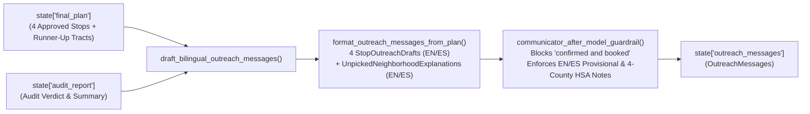

# `carebridge.agents.communicator_agent` — Community Communications Agent (Plan 08)

The [`carebridge/agents/communicator_agent/`](file:///Users/dvt112/Downloads/A4I/carebridge/agents/communicator_agent/__init__.py) package implements **Track 3: The Community Communications Agent (`community_communications_agent`)**, which translates the audited final 4-stop Saturday clinic plan into respectful, plain-language **English and Spanish (`OutreachMessages`)** community notices and transparent runner-up neighborhood explanations (Question 7).

---

## Responsibilities & Guardrail Flow



---

## Key Files & Communication Safeguards

### 1. [`prompt.py`](file:///Users/dvt112/Downloads/A4I/carebridge/agents/communicator_agent/prompt.py)
Defines [`COMMUNICATOR_AGENT_INSTRUCTION`](file:///Users/dvt112/Downloads/A4I/carebridge/agents/communicator_agent/prompt.py#L6-L56):
- Reads `{final_plan?}` (falling back to `{draft_plan?}`) and `{audit_report?}` from `session.state`.
- Calls `draft_bilingual_outreach_messages` to generate:
  1. **4 Bilingual Stop Notices (`stop_notices`)**: Plain-language English (`english_notice`) and Spanish (`spanish_notice`) announcements for Stops `#1`–`#4`, grounded in preventive care needs (`why_chosen_explanation`).
  2. **Mandatory Provisional Disclaimers**: Every stop notice must clearly state `"PROPOSED LOCATION — PENDING HOST SITE CONFIRMATION"` in English and `"UBICACIÓN PROPUESTA — PENDIENTE DE CONFIRMACIÓN DEL SITIO ANFITRIÓN"` in Spanish (`provisional_disclaimer_included = True`).
  3. **Counterfactual Explanations for Unpicked Neighborhoods (`unpicked_neighborhood_explanations`, Question 7)**: Bilingual explanations for high-need runner-up tracts (`need_rank >= 5`, e.g., Cascade Corridor `13121007808` and Fairburn/Union City `13121010305`) explaining why they were not chosen as primary anchors and directing residents to the nearest selected Saturday stop (`nearest_selected_stop_rank`, `distance_to_selected_stop_km`).
  4. **Regional Surveillance Grain Transparency (`regional_surveillance_note_en` / `regional_surveillance_note_es`)**: Explicitly states in both languages that weekly respiratory trends (`COVID-19`, `Influenza`, `RSV`) come from the **4-county Health Service Area (HSA)** covering Fulton, DeKalb, Clayton, and Gwinnett.

### 2. [`agent.py`](file:///Users/dvt112/Downloads/A4I/carebridge/agents/communicator_agent/agent.py)
- **[`FORBIDDEN_BOOKING_PATTERNS`](file:///Users/dvt112/Downloads/A4I/carebridge/agents/communicator_agent/agent.py#L36-L46)**:
  Regex list blocking any false certainty in English or Spanish (`confirmed and booked`, `officially booked`, `guaranteed host`, `confirmado y reservado`, `oficialmente reservado`).
- **[`format_outreach_messages_from_plan(plan, county_name="Fulton")`](file:///Users/dvt112/Downloads/A4I/carebridge/agents/communicator_agent/agent.py#L144-L280)**:
  Deterministically constructs a validated [`OutreachMessages`](file:///Users/dvt112/Downloads/A4I/carebridge/contracts/outreach_models.py#L68-L96) object from any `DraftPlan`, translating deferral reason codes and recommended preventive services into natural English and Spanish.
- **[`communicator_after_model_guardrail(callback_context, llm_response)`](file:///Users/dvt112/Downloads/A4I/carebridge/agents/communicator_agent/agent.py#L329-L386)**:
  - Runs `after_model_guardrail_callback` (PII check).
  - Scans output text against `FORBIDDEN_BOOKING_PATTERNS` and raises `PolicyViolationError` on any match.
  - Parses the response into `OutreachMessages` and verifies that every `StopOutreachDraft` includes `"proposed location"` / `"pending host"` in English and `"ubicación propuesta"` / `"pendiente de confirmación"` in Spanish, and that both `regional_surveillance_note_en` and `regional_surveillance_note_es` cite the 4-county HSA.
- **[`build_community_communications_agent(model=None)`](file:///Users/dvt112/Downloads/A4I/carebridge/agents/communicator_agent/agent.py#L389-L413)**:
  Builds the Google ADK `LlmAgent` (`name="community_communications_agent"`, `output_key="outreach_messages"`, `output_schema=OutreachMessages`).

---

## Verification

Tested in [`tests/test_08_communicator_agent.py`](file:///Users/dvt112/Downloads/A4I/tests/test_08_communicator_agent.py):
```bash
pytest tests/test_08_communicator_agent.py -v
```
