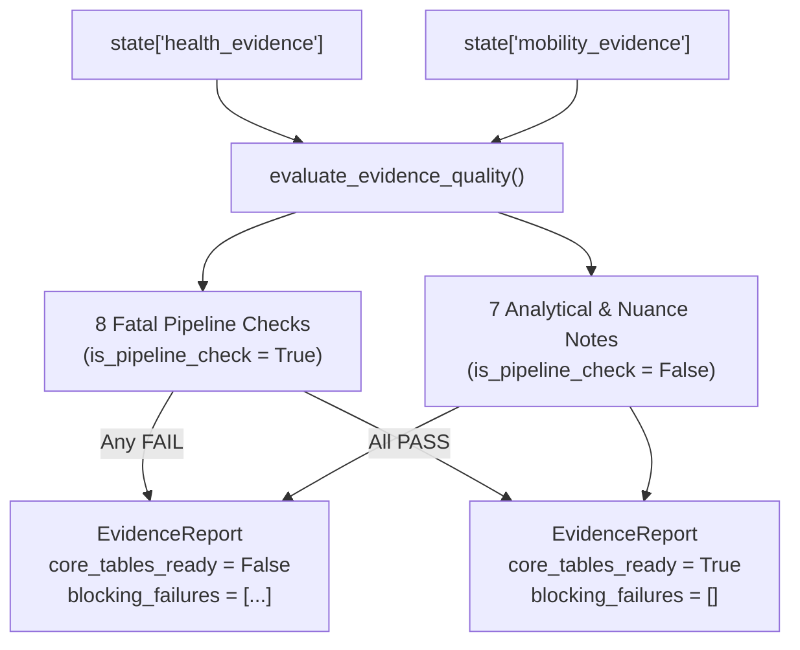

# `carebridge.agents.validator_agent` — Evidence Validator Agent (Plan 04)

The [`carebridge/agents/validator_agent/`](file:///Users/dvt112/Downloads/A4I/carebridge/agents/validator_agent/__init__.py) package implements the **Evidence Validator Agent (`evidence_validator_agent`)**, the sequential data-quality gate that runs immediately after `ParallelEvidenceGatherer` (`health_access_agent` + `transit_community_agent`) and before `PlanAndAuditLoop`.

---

## Dual-Layer Validation Architecture (`check()` vs. `note()`)



---

## 8 Fatal `check()` Rules vs. 7 Non-Fatal `note()` Rules

Implemented in [`evaluate_evidence_quality()`](file:///Users/dvt112/Downloads/A4I/carebridge/agents/validator_agent/agent.py#L72-L370):

### Fatal Pipeline Checks (`is_pipeline_check=True` — Failure sets `core_tables_ready=False`)
1. `core_tracts_non_empty`: Confirms `len(health_evidence.tracts) >= 1`.
2. `tract_geoid_11char_and_county_prefix`: Verifies every tract `geo_id` in both `health_evidence` and `mobility_evidence` is an 11-digit string starting with `county_fips` (e.g., `"13121"`). Rejects 10-character IDs or out-of-county tracts (e.g., `"13089"` DeKalb).
3. `tract_geoid_no_duplicates`: Verifies 1:1 join integrity with zero duplicate `geo_id` rows.
4. `tract_coordinates_in_bounds`: Verifies valid North America coordinates (`24.0 <= lat <= 50.0`, `-125.0 <= lon <= -66.0`).
5. `core_care_sites_and_access_present`: Verifies `care_sites_count > 0` and finite `km_to_nearest_care_site` / `km_to_nearest_safety_net`.
6. `pct_checkup_preventive_inversion`: Verifies `pct_checkup + pct_checkup_gap == 100.0` (within `0.05` tolerance) so preventive care attendance is never conflated with unmet need.
7. `disease_weekly_hsa_grain`: Verifies `regional_disease.spatial_grain == SpatialGrain.MULTI_COUNTY_HSA`.
8. `race_blind_and_pii_exclusion`: Runs `assert_race_blind_planner_input()` and `assert_no_pii_in_payload()` across both evidence payloads.

### Non-Fatal Analytical Notes (`is_pipeline_check=False` — Logged as `PASS`/`WARN`, never halts pipeline)
1. `prevalence_percentages_in_bounds`: Verifies prevalence/insurance/vehicle percentages lie in `[0, 100]`.
2. `tract_centroid_completeness`: Checks whether any tracts are missing lat/lon centroids.
3. `zero_population_or_suppressed_tracts`: Flags tracts with `total_pop <= 0`.
4. `access_distances_plausible_range`: Checks that distances to care sites lie in `[0, 100]` km.
5. `hpsa_shortage_area_vs_facility_nuance`: Records `WARN` when `shortage_areas_count == 0` while `shortage_facilities_count > 0` (the real Fulton County finding: `0` geographic HPSA polygons vs. `6` shortage facilities).
6. `disease_weekly_missingness_flag`: Records `WARN` if weekly NSSP ED values are `NULL` (`data_unavailable=True`).
7. `optional_datasets_availability`: Records the availability status of `marta_gtfs`, `usda_food_access`, and `imls_candidate_venues`.

---

## Mandatory Spatial Grain Caveats

Defined in [`MANDATORY_EVIDENCE_CAVEATS`](file:///Users/dvt112/Downloads/A4I/carebridge/agents/validator_agent/prompt.py#L8-L33) and guaranteed on every [`EvidenceReport`](file:///Users/dvt112/Downloads/A4I/carebridge/contracts/evidence_models.py#L246-L273):
1. **CDC PLACES (`burden_tracts`)**: Model-based small-area estimates (`pct_checkup` inverted to `pct_checkup_gap`).
2. **CDC NSSP (`disease_weekly`)**: 4-county Health Service Area grain (`Fulton, DeKalb, Clayton, Gwinnett`).
3. **EPA Air Quality (`cma_aq`)**: 12 km grid cells mapped to tracts (`pm25_days_over_20` differentiates local tail exposure).
4. **HRSA (`shortage_areas` vs. `care_sites`)**: Fulton has `0` active geographic Primary Care HPSA polygons (`shortage_areas_count=0`) but `6` facility-level HPSA designations (`shortage_facilities_count=6`).
5. **MARTA GTFS (`v_tract_saturday_transit_access`)**: Measures 400 m stop proximity (`08:00–18:00`), not end-to-end rider travel time.

---

## Verification

Tested in [`tests/test_04_validator_agent.py`](file:///Users/dvt112/Downloads/A4I/tests/test_04_validator_agent.py):
```bash
pytest tests/test_04_validator_agent.py -v
```
