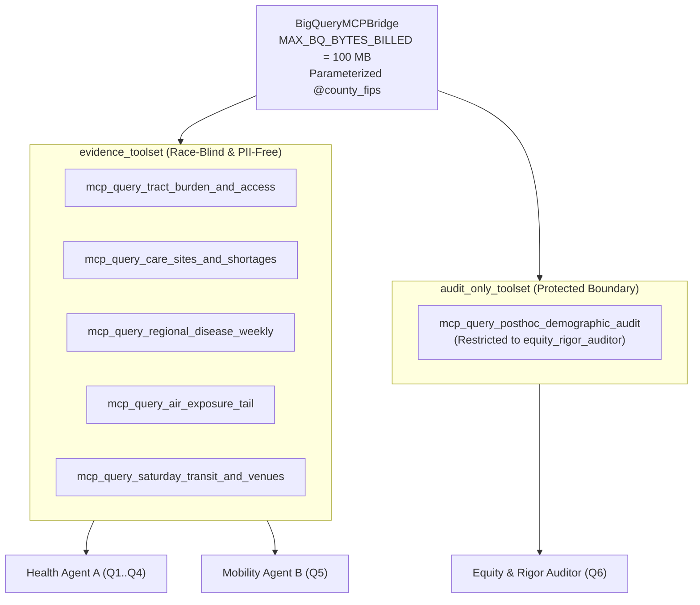

# `carebridge.data_plane` — BigQuery MCP Bridge, Toolset Boundary & Validators (Plan 01)

The [`carebridge/data_plane/`](file:///Users/dvt112/Downloads/A4I/carebridge/data_plane/__init__.py) package implements the read-only BigQuery data plane, MCP Toolbox configuration, physical toolset isolation between Evidence Agents and the Equity Auditor, cost-control query caps, and deterministic data validators.

---

## Toolset Isolation Architecture



---

## Key Modules

### 1. [`bq_mcp_client.py`](file:///Users/dvt112/Downloads/A4I/carebridge/data_plane/bq_mcp_client.py)
Implements [`BigQueryMCPBridge`](file:///Users/dvt112/Downloads/A4I/carebridge/data_plane/bq_mcp_client.py#L46-L407):
- **Cost & Injection Controls**:
  - Enforces [`MAX_BQ_BYTES_BILLED = 100_000_000`](file:///Users/dvt112/Downloads/A4I/carebridge/data_plane/bq_mcp_client.py#L36) (100 MB per query) via `get_query_job_config(county_fips)`.
  - Requires strict 5-digit `county_fips` validation (`^\d{5}$`) via [`validate_county_fips()`](file:///Users/dvt112/Downloads/A4I/carebridge/data_plane/data_validator.py#L19-L26) before binding `@county_fips`.
  - Emits OpenTelemetry spans (`bq.mcp.<tool_name>`) with `county_fips`, `maximum_bytes_billed`, and `rows_returned`.
- **6 Named MCP Queries**:
  1. `mcp_query_tract_burden_and_access(county_fips)` — Joins `burden_tracts` + `access_tracts` + `cma_aq` on 11-char `geo_id`, computing `pct_checkup_gap = 100.0 - pct_checkup` and stripping `rpl_theme3` and `rpl_themes`.
  2. `mcp_query_care_sites_and_shortages(county_fips)` — Summarizes `care_sites` (`tot_oper_hr_per_week`, zero admin PII), `shortage_areas` (`0` in Fulton), and `shortage_facilities` (`6` in Fulton).
  3. `mcp_query_regional_disease_weekly(county_fips)` — Queries `disease_weekly` at the 4-county Health Service Area grain (`Fulton, DeKalb, Clayton, Gwinnett`).
  4. `mcp_query_air_exposure_tail(county_fips)` — Queries `cma_aq` 12 km grid tail metrics (`pm25_days_over_20`).
  5. `mcp_query_saturday_transit_and_venues(county_fips, include_optional_datasets=True)` — Queries MARTA Saturday GTFS stop proximity (`08:00–18:00`), USDA Food Access, and IMLS libraries; catches `BigQueryNotFoundError` / `NotFound` and returns `MobilityEvidence(marta_gtfs_available=False, ...)` with explicit caveats rather than crashing.
  6. `mcp_query_posthoc_demographic_audit(county_fips, caller_agent="equity_rigor_auditor")` — Queries `external_demographic_audit.tract_demographics_audit`; raises `PolicyViolationError` if `caller_agent != "equity_rigor_auditor"`.
- **Scoped Toolset Factories**:
  - [`get_health_evidence_mcp_tools(bridge)`](file:///Users/dvt112/Downloads/A4I/carebridge/data_plane/bq_mcp_client.py#L410-L418): Returns `[Q1, Q2, Q3, Q4]` for Evidence Agent A.
  - [`get_mobility_evidence_mcp_tools(bridge)`](file:///Users/dvt112/Downloads/A4I/carebridge/data_plane/bq_mcp_client.py#L421-L429): Returns `[Q5, query_candidate_venues, query_food_access_enrichment]` for Evidence Agent B.
  - [`get_evidence_toolset(bridge)`](file:///Users/dvt112/Downloads/A4I/carebridge/data_plane/bq_mcp_client.py#L440-L443): Combined Track 1 evidence tools (`isdisjoint` from Auditor tools).
  - [`get_auditor_demographic_mcp_tools(bridge)`](file:///Users/dvt112/Downloads/A4I/carebridge/data_plane/bq_mcp_client.py#L432-L437): Returns `[mcp_query_posthoc_demographic_audit]` exclusively for the Equity & Rigor Auditor.

### 2. [`data_validator.py`](file:///Users/dvt112/Downloads/A4I/carebridge/data_plane/data_validator.py)
Provides deterministic data-plane checks:
- [`validate_county_fips(county_fips)`](file:///Users/dvt112/Downloads/A4I/carebridge/data_plane/data_validator.py#L19-L26): Enforces `^\d{5}$` regex.
- [`validate_evidence_payload(payload)`](file:///Users/dvt112/Downloads/A4I/carebridge/data_plane/data_validator.py#L29-L36): Runs both `assert_no_pii_in_payload(payload)` and `assert_race_blind_planner_input(payload)`.
- [`validate_tract_geoid_rows(rows, expected_county_fips)`](file:///Users/dvt112/Downloads/A4I/carebridge/data_plane/data_validator.py#L39-L57): Verifies every `geo_id` is an 11-digit string starting with `expected_county_fips`.
- [`enforce_unverified_host_venues(venues)`](file:///Users/dvt112/Downloads/A4I/carebridge/data_plane/data_validator.py#L60-L68): Forces `host_permission_verified = False` on all candidate venue dicts.

### 3. [`mcp_tools.yaml`](file:///Users/dvt112/Downloads/A4I/carebridge/data_plane/mcp_tools.yaml)
Declarative MCP Toolbox for Databases configuration defining `sources.a4i_bigquery`, parameterized SQL statements for all 6 tools, and separate `evidence_toolset` vs. `audit_only_toolset` bundles.

### 4. [`sql/`](file:///Users/dvt112/Downloads/A4I/carebridge/data_plane/sql/README.md)
BigQuery SQL view DDL scripts (`01_marta_gtfs_views.sql`, `02_optional_enrichments.sql`, `03_demographic_audit_table.sql`).

---

## Verification

Tested in [`tests/test_01_bigquery_mcp.py`](file:///Users/dvt112/Downloads/A4I/tests/test_01_bigquery_mcp.py):
```bash
pytest tests/test_01_bigquery_mcp.py -v
```
