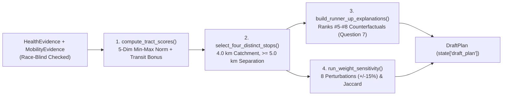

# `carebridge.tools.optimizer` — Four-Stop Coverage Optimizer Tool (Plan 05)

The [`carebridge/tools/optimizer/`](file:///Users/dvt112/Downloads/A4I/carebridge/tools/optimizer/__init__.py) package implements the deterministic, race-blind spatial optimization engine used by the Siting Planner Agent (Plan 06) to select **4 distinct Saturday mobile clinic stops**, explain **runner-up neighborhoods (`#5`–`#8`, Question 7)**, and evaluate **$\pm 15\%$ weight perturbation sensitivity**.

---

## Optimization Pipeline



---

## Modules & Algorithms

### 1. [`scoring.py`](file:///Users/dvt112/Downloads/A4I/carebridge/tools/optimizer/scoring.py)
Implements within-county min-max normalization (`[0.0, 1.0]`), Haversine distance geometry, and strategy-specific composite need scoring:
- **[`STRATEGY_WEIGHTS`](file:///Users/dvt112/Downloads/A4I/carebridge/tools/optimizer/scoring.py#L16-L38)**:
  Defines weights across 5 race-blind clinical/access dimensions (summing to `1.0`):

  | Dimension | `balanced_uninsured_safety_net_gap` | `chronic_respiratory_focus` | `zero_vehicle_transit_priority` |
  | :--- | :---: | :---: | :---: |
  | `uninsured_gap` (`pct_uninsured_18_64`) | `0.30` | `0.20` | `0.25` |
  | `safety_net_distance` (`km_to_nearest_safety_net`) | `0.25` | `0.20` | `0.20` |
  | `zero_vehicle` (`pct_no_vehicle`) | `0.20` | `0.15` | `0.35` |
  | `chronic_respiratory` (diabetes, HBP, asthma, PM2.5 tail) | `0.15` | `0.35` | `0.10` |
  | `checkup_preventive_gap` (`100 - pct_checkup`) | `0.10` | `0.10` | `0.10` |

- **Composite Need Formula**:
  $$\text{composite\_need\_score} = \text{round}\left(0.96 \times \sum_{k} w_k x_{i,k} + 0.04 \times \text{saturday\_transit\_access\_bonus}_i,\; 4\right)$$
  Every [`ScoreBreakdown`](file:///Users/dvt112/Downloads/A4I/carebridge/contracts/plan_models.py#L14-L39) carries `estimate_kind = DataEstimateKind.HEURISTIC_COMPOSITE`.
- **[`haversine_km(lat1, lon1, lat2, lon2)`](file:///Users/dvt112/Downloads/A4I/carebridge/tools/optimizer/scoring.py#L41-L55)**: Great-circle distance in kilometers ($R = 6371.0088\text{ km}$).

### 2. [`coverage.py`](file:///Users/dvt112/Downloads/A4I/carebridge/tools/optimizer/coverage.py)
Implements greedy maximum-coverage stop selection and runner-up explanations:
- **[`select_four_distinct_stops()`](file:///Users/dvt112/Downloads/A4I/carebridge/tools/optimizer/coverage.py#L121-L246)**:
  - Evaluates a `4.0 km` catchment radius (`DEFAULT_CATCHMENT_RADIUS_KM = 4.0`) around each candidate tract centroid.
  - Discounts already-covered tracts by `OVERLAP_DISCOUNT_FACTOR = 0.15` (an `85%` penalty on redundant coverage) so each new stop maximizes marginal newly covered need-weighted population.
  - Enforces a minimum inter-stop Haversine separation of `MIN_INTER_STOP_SEPARATION_KM = 5.0` km.
  - Assigns provisional candidate venues (`host_verified = False`, `provisional_warning` banner) and tailors `recommended_services` and `evidence_citations` to the tract's specific burden indicators.
  - Supports controlled revision-loop testing (`simulate_first_draft_defect=True` when `revision_number == 0`), intentionally placing Stop `#2` within `< 5.0 km` of Stop `#1` and injecting a spatial grain overclaim so the Equity & Rigor Auditor (Plan 07) can demonstrate rejection and automated repair on `revision_number == 1`.
- **[`build_runner_up_explanations()`](file:///Users/dvt112/Downloads/A4I/carebridge/tools/optimizer/coverage.py#L249-L315)**:
  - Inspects high-need tracts not selected as primary anchors (`need_rank` `#5`–`#8`, Question 7) and classifies each with a deterministic `deferral_reason_code` (`catchment_already_covered`, `inter_stop_separation_constraint`, `no_saturday_transit_or_venue`, or `lower_marginal_coverage`), recording `nearest_selected_stop_rank` and `distance_to_nearest_stop_km`.

### 3. [`sensitivity.py`](file:///Users/dvt112/Downloads/A4I/carebridge/tools/optimizer/sensitivity.py)
Implements [`run_weight_sensitivity()`](file:///Users/dvt112/Downloads/A4I/carebridge/tools/optimizer/sensitivity.py#L38-L119):
- Runs **8 deterministic $\pm 15\%$ single-dimension weight perturbations** (`+15%` and `-15%` on each of the 4 primary dimensions, renormalized to `1.0`).
- Computes the Jaccard similarity $J(A, B) = \frac{|A \cap B|}{|A \cup B|}$ between the baseline top-4 primary tracts and each perturbed top-4 set.
- Identifies `core_stable_tract_geoids` (appearing in $\ge 75\%$ of runs) and `borderline_swapped_tract_geoids`.

### 4. [`tool.py`](file:///Users/dvt112/Downloads/A4I/carebridge/tools/optimizer/tool.py)
Exposes [`optimize_four_clinic_stops()`](file:///Users/dvt112/Downloads/A4I/carebridge/tools/optimizer/tool.py#L41-L162) as a Google ADK tool function that reads `state["health_evidence"]`, `state["mobility_evidence"]`, and `state["non_demographic_feedback"]`, validates race-blind inputs/outputs, writes `state["draft_plan"]`, and emits the `tool.optimizer.optimize_four_clinic_stops` OpenTelemetry span.

---

## Verification

Tested in [`tests/test_05_optimizer_tool.py`](file:///Users/dvt112/Downloads/A4I/tests/test_05_optimizer_tool.py):
```bash
pytest tests/test_05_optimizer_tool.py -v
```
