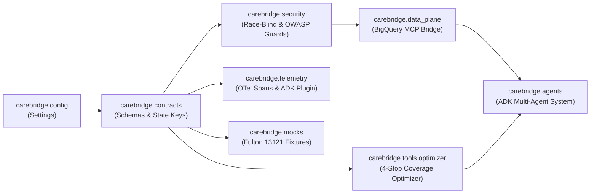

# `carebridge` — Core Package Overview

The [`carebridge`](file:///Users/dvt112/Downloads/A4I/carebridge/__init__.py) package implements the CareBridge Fulton multi-agent mobile health siting co-pilot. It is designed with strict separation between data contracts, security guardrails, BigQuery MCP data plane access, deterministic spatial optimization tools, and Google ADK agent workflows.

---

## Package Architecture

---

## Top-Level Modules

### 1. [`config.py`](file:///Users/dvt112/Downloads/A4I/carebridge/config.py)
Centralizes environment-driven runtime settings via [`Settings`](file:///Users/dvt112/Downloads/A4I/carebridge/config.py#L14-L53) and the cached [`get_settings()`](file:///Users/dvt112/Downloads/A4I/carebridge/config.py#L56-L58) factory.

| Setting Field | Default Value | Purpose |
| :--- | :--- | :--- |
| `google_cloud_project` | `"a4i-fulton-2026"` | Google Cloud project ID for Vertex AI and BigQuery |
| `google_cloud_location` | `"us-central1"` | Vertex AI region |
| `bigquery_dataset` | `"a4i_health"` | Core public-health BigQuery dataset (`burden_tracts`, `access_tracts`, `care_sites`, `shortage_areas`, `disease_weekly`, `cma_aq`) |
| `bigquery_marta_dataset` | `"marta_gtfs"` | Optional MARTA GTFS Saturday transit dataset |
| `bigquery_audit_dataset` | `"external_demographic_audit"` | Protected post-hoc demographic dataset restricted to the Auditor Agent |
| `default_county_fips` | `"13121"` | Default 5-digit county FIPS code (Fulton County, GA) |
| `gemini_model_fast` | `"gemini-2.5-flash"` | Default model for Evidence Agents A & B, Validator, and Communicator |
| `gemini_model_reasoning` | `"gemini-2.5-pro"` | Default reasoning model for Siting Planner and Equity & Rigor Auditor |
| `use_mock_data` | `True` | Enables deterministic offline execution using Fulton County fixtures when BigQuery credentials are absent |
| `enable_model_armor` | `True` | Enables prompt/SQL injection and policy bypass screening |
| `max_audit_revisions` | `1` | Maximum revision loopbacks (`Draft 0` $\rightarrow$ `Draft 1`) |

### 2. [`_compat.py`](file:///Users/dvt112/Downloads/A4I/carebridge/_compat.py)
Provides a resilient compatibility layer so all CareBridge contracts, tools, and tests run identically whether `pydantic`, `pydantic-settings`, and `google-genai` are installed in a full cloud container or executed in a minimal sandboxed CI environment:
- Exports `BaseModel`, `Field`, `ValidationError`, `field_validator`, `model_validator`, and `ConfigDict`.
- Exports `BaseSettings` and `SettingsConfigDict`.
- Exports `SafetySetting`, `HarmCategory`, `HarmBlockThreshold`, and `GenerateContentConfig`.

---

## Subpackages Index

- **[`carebridge/contracts/`](file:///Users/dvt112/Downloads/A4I/carebridge/contracts/README.md)**: Typed Pydantic models (`HealthEvidence`, `MobilityEvidence`, `EvidenceReport`, `DraftPlan`, `AuditReport`, `OutreachMessages`, `PlanRequest`, `PlanResponse`) and ADK `session.state` key constants.
- **[`carebridge/security/`](file:///Users/dvt112/Downloads/A4I/carebridge/security/README.md)**: Structural race-blind Planner guards (`assert_race_blind_planner_input`), PII guards (`assert_no_pii_in_payload`), Model Armor screening, and OWASP LLM Top 10 ADK callbacks.
- **[`carebridge/telemetry/`](file:///Users/dvt112/Downloads/A4I/carebridge/telemetry/README.md)**: OpenTelemetry span context manager (`trace_span`), structured Cloud Logging helper (`record_structured_log`), and `CareBridgeTelemetryPlugin`.
- **[`carebridge/mocks/`](file:///Users/dvt112/Downloads/A4I/carebridge/mocks/README.md)**: Realistic 12-tract Fulton County (`13121`) fixtures across South Fulton, Tri-Cities, Westside, Midtown, and North Fulton.
- **[`carebridge/data_plane/`](file:///Users/dvt112/Downloads/A4I/carebridge/data_plane/README.md)**: `BigQueryMCPBridge`, 100 MB per-query billing cap, toolset permission isolation, data validators, and BigQuery SQL setup scripts ([`carebridge/data_plane/sql/`](file:///Users/dvt112/Downloads/A4I/carebridge/data_plane/sql/README.md)).
- **[`carebridge/tools/`](file:///Users/dvt112/Downloads/A4I/carebridge/tools/README.md)** & **[`carebridge/tools/optimizer/`](file:///Users/dvt112/Downloads/A4I/carebridge/tools/optimizer/README.md)**: Deterministic 4-stop maximum coverage optimizer, Haversine distance & separation enforcement, runner-up counterfactual explanations, and $\pm 15\%$ weight perturbation sensitivity analysis.
- **[`carebridge/agents/`](file:///Users/dvt112/Downloads/A4I/carebridge/agents/README.md)**:
  - [`health_agent/`](file:///Users/dvt112/Downloads/A4I/carebridge/agents/health_agent/README.md)
  - [`mobility_agent/`](file:///Users/dvt112/Downloads/A4I/carebridge/agents/mobility_agent/README.md)
  - [`validator_agent/`](file:///Users/dvt112/Downloads/A4I/carebridge/agents/validator_agent/README.md)
  - [`planner_agent/`](file:///Users/dvt112/Downloads/A4I/carebridge/agents/planner_agent/README.md)
  - [`auditor_agent/`](file:///Users/dvt112/Downloads/A4I/carebridge/agents/auditor_agent/README.md)
  - [`communicator_agent/`](file:///Users/dvt112/Downloads/A4I/carebridge/agents/communicator_agent/README.md)
- **[`carebridge/docs/`](file:///Users/dvt112/Downloads/A4I/carebridge/docs/README.md)**: Challenge 5 Public Health specification traceability, multi-agent architecture guarantees, and E2E test verification reports:
  - [`challenge_5_test_cases.md`](file:///Users/dvt112/Downloads/A4I/carebridge/docs/challenge_5_test_cases.md)
  - [`e2e_verification_report.md`](file:///Users/dvt112/Downloads/A4I/carebridge/docs/e2e_verification_report.md)
  - [`multi_agent_architecture_guarantees.md`](file:///Users/dvt112/Downloads/A4I/carebridge/docs/multi_agent_architecture_guarantees.md)
