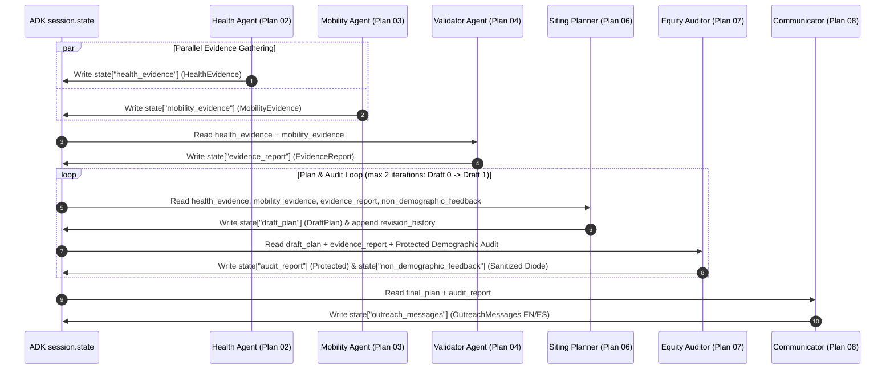

# `carebridge.agents` — Multi-Agent ADK Architecture (Plans 02–04, 06–08)

The [`carebridge/agents/`](file:///Users/dvt112/Downloads/A4I/carebridge/agents/__init__.py) package contains the six specialized Google ADK `LlmAgent` modules implemented across **Plans 02, 03, 04, 06, 07, and 08**. Each agent operates within a strict permission boundary, reads and writes typed Pydantic models via dedicated `session.state` keys, and is protected by OWASP LLM Top 10 and race-blind callbacks.

---

## Agent Topology & State Flow

---

## Agent Directory & Track Matrix

| Agent Directory | Plan | ADK Agent Name | Track & Role | Model | Output Key & Schema |
| :--- | :--- | :--- | :--- | :--- | :--- |
| **[`health_agent/`](file:///Users/dvt112/Downloads/A4I/carebridge/agents/health_agent/README.md)** | **Plan 02** | `health_access_agent` | **Track 1 (Evidence A)**: Queries `burden_tracts`, `access_tracts`, `care_sites`, `shortage_areas`, `disease_weekly`, and `cma_aq` | `gemini-2.5-flash` | `health_evidence` ([`HealthEvidence`](file:///Users/dvt112/Downloads/A4I/carebridge/contracts/evidence_models.py#L128-L157)) |
| **[`mobility_agent/`](file:///Users/dvt112/Downloads/A4I/carebridge/agents/mobility_agent/README.md)** | **Plan 03** | `transit_community_agent` | **Track 1 (Evidence B)**: Queries Saturday MARTA GTFS stop proximity, USDA Food Access, and IMLS candidate venues with graceful degradation | `gemini-2.5-flash` | `mobility_evidence` ([`MobilityEvidence`](file:///Users/dvt112/Downloads/A4I/carebridge/contracts/evidence_models.py#L205-L227)) |
| **[`validator_agent/`](file:///Users/dvt112/Downloads/A4I/carebridge/agents/validator_agent/README.md)** | **Plan 04** | `evidence_validator_agent` | **Track 1 (Quality Gate)**: Runs 8 fatal `check()` rules and 7 analytical `note()` rules across 5 spatial grains | `gemini-2.5-flash` | `evidence_report` ([`EvidenceReport`](file:///Users/dvt112/Downloads/A4I/carebridge/contracts/evidence_models.py#L246-L273)) |
| **[`planner_agent/`](file:///Users/dvt112/Downloads/A4I/carebridge/agents/planner_agent/README.md)** | **Plan 06** | `siting_planner_agent` | **Track 1 (Advisor — Race-Blind)**: Invokes `optimize_four_clinic_stops` to select 4 Saturday stops and explain runner-up tracts (`#5`–`#8`) | `gemini-2.5-pro` | `draft_plan` ([`DraftPlan`](file:///Users/dvt112/Downloads/A4I/carebridge/contracts/plan_models.py#L150-L185)) |
| **[`auditor_agent/`](file:///Users/dvt112/Downloads/A4I/carebridge/agents/auditor_agent/README.md)** | **Plan 07** | `equity_rigor_auditor` | **Track 2 (Auditor — Protected)**: Audits methodological rigor, queries `external_demographic_audit`, and enforces the One-Way Demographic Diode | `gemini-2.5-pro` | `audit_report` ([`AuditReport`](file:///Users/dvt112/Downloads/A4I/carebridge/contracts/audit_models.py#L85-L116)) |
| **[`communicator_agent/`](file:///Users/dvt112/Downloads/A4I/carebridge/agents/communicator_agent/README.md)** | **Plan 08** | `community_communications_agent` | **Track 3 (Communicator)**: Drafts bilingual (EN/ES) notices for selected stops and counterfactual explanations for unpicked neighborhoods | `gemini-2.5-flash` | `outreach_messages` ([`OutreachMessages`](file:///Users/dvt112/Downloads/A4I/carebridge/contracts/outreach_models.py#L68-L96)) |
