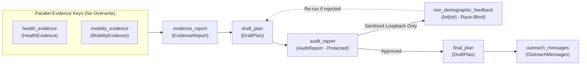

# `carebridge.contracts` — Typed Data Contracts & ADK State Boundaries (Plan 00)

The [`carebridge/contracts/`](file:///Users/dvt112/Downloads/A4I/carebridge/contracts/__init__.py) package defines all inter-agent Pydantic schemas and ADK `session.state` keys for CareBridge Fulton. No agent or tool passes untyped dictionaries across boundaries without validating against these contracts.

---

## State Key Isolation & The One-Way Demographic Diode

Defined in [`state_keys.py`](file:///Users/dvt112/Downloads/A4I/carebridge/contracts/state_keys.py):



### Scoped State Key Visibility Sets
- **[`PLANNER_VISIBLE_STATE_KEYS`](file:///Users/dvt112/Downloads/A4I/carebridge/contracts/state_keys.py#L46-L54)**: `plan_request`, `request_id`, `health_evidence`, `mobility_evidence`, `evidence_report`, `draft_plan`, `non_demographic_feedback`, `revision_history`, `iteration_count`. **Explicitly excludes `audit_report`**.
- **[`SANITIZED_LOOPBACK_STATE_KEYS`](file:///Users/dvt112/Downloads/A4I/carebridge/contracts/state_keys.py#L58-L62)**: `revision_required`, `non_demographic_feedback`, `iteration_count`.
- **[`AUDITOR_AND_POST_PLANNER_STATE_KEYS`](file:///Users/dvt112/Downloads/A4I/carebridge/contracts/state_keys.py#L65-L69)**: `audit_report`, `final_plan`, `outreach_messages`.

---

## Contract Modules

### 1. [`evidence_models.py`](file:///Users/dvt112/Downloads/A4I/carebridge/contracts/evidence_models.py)
Models multi-resolution public health and mobility evidence:
- **[`SpatialGrain`](file:///Users/dvt112/Downloads/A4I/carebridge/contracts/evidence_models.py#L14-L23)**: Enumerates the 5 distinct data grains:
  - `census_tract_11char` (`burden_tracts`, `access_tracts`)
  - `epa_12km_grid_on_tract_id` (`cma_aq`)
  - `facility_lon_lat_point` (`care_sites`)
  - `hrsa_mixed_grain_component` (`shortage_areas`)
  - `multi_county_health_service_area` (`disease_weekly` — 4-county HSA)
- **[`TractHealthRecord`](file:///Users/dvt112/Downloads/A4I/carebridge/contracts/evidence_models.py#L36-L97)**: 11-character census tract record with automatic preventive care gap inversion:
  $$\text{pct\_checkup\_gap} = \text{round}(100.0 - \text{pct\_checkup}, 2)$$
  Also computes `pct_uninsured_18_64_ci_width` and `extra_km_if_uninsured` (`km_to_nearest_safety_net - km_to_nearest_care_site`).
- **[`RegionalDiseaseSignal`](file:///Users/dvt112/Downloads/A4I/carebridge/contracts/evidence_models.py#L100-L125)**: Enforces `SpatialGrain.MULTI_COUNTY_HSA` across Fulton, DeKalb, Clayton, and Gwinnett (`nssp_ed_trajectory` — never mistaken for tract prevalence).
- **[`HealthEvidence`](file:///Users/dvt112/Downloads/A4I/carebridge/contracts/evidence_models.py#L128-L157)**: Output schema of Evidence Agent A (`state["health_evidence"]`). Captures Fulton's HPSA nuance (`shortage_areas_count=0` vs `shortage_facilities_count=6`).
- **[`CandidateHostVenue`](file:///Users/dvt112/Downloads/A4I/carebridge/contracts/evidence_models.py#L160-L176)**, **[`TractMobilityRecord`](file:///Users/dvt112/Downloads/A4I/carebridge/contracts/evidence_models.py#L179-L202)**, **[`MobilityEvidence`](file:///Users/dvt112/Downloads/A4I/carebridge/contracts/evidence_models.py#L205-L227)**: Output schema of Evidence Agent B (`state["mobility_evidence"]`). Defaults `host_permission_verified = False`.
- **[`ValidationCheckItem`](file:///Users/dvt112/Downloads/A4I/carebridge/contracts/evidence_models.py#L230-L243)** & **[`EvidenceReport`](file:///Users/dvt112/Downloads/A4I/carebridge/contracts/evidence_models.py#L246-L273)**: Output schema of the Evidence Validator Agent (`state["evidence_report"]`), distinguishing fatal pipeline checks (`is_pipeline_check=True`) from non-fatal analytical notes (`is_pipeline_check=False`).

### 2. [`plan_models.py`](file:///Users/dvt112/Downloads/A4I/carebridge/contracts/plan_models.py)
Models the race-blind siting plan and counterfactual explanations:
- **[`ScoreBreakdown`](file:///Users/dvt112/Downloads/A4I/carebridge/contracts/plan_models.py#L14-L39)**: Transparent component breakdown (`uninsured_gap_norm`, `safety_net_distance_norm`, `zero_vehicle_norm`, `chronic_respiratory_norm`, `checkup_preventive_gap_norm`, `saturday_transit_access_bonus`, `composite_need_score`, and `estimate_kind="heuristic_composite_score"`).
- **[`ProposedClinicStop`](file:///Users/dvt112/Downloads/A4I/carebridge/contracts/plan_models.py#L42-L90)**: One of the 4 Saturday clinic stops (`stop_rank` 1..4), including `covered_tract_geoids`, `marginal_ newly_covered_tracts`, `recommended_services`, `evidence_citations`, and `host_verified=False`.
- **[`RunnerUpTractExplanation`](file:///Users/dvt112/Downloads/A4I/carebridge/contracts/plan_models.py#L93-L124)**: Answers Question 7 for high-need runner-up tracts (`need_rank >= 5`) not selected as primary anchors, recording `deferral_reason_code`, `nearest_selected_stop_rank`, and `distance_to_nearest_stop_km`.
- **[`SensitivitySummary`](file:///Users/dvt112/Downloads/A4I/carebridge/contracts/plan_models.py#L127-L147)**: Summarizes top-4 stability across $\pm 15\%$ weight perturbations (`perturbation_pct=15.0`, `mean_jaccard_similarity`, `core_stable_tract_geoids`, `borderline_swapped_tract_geoids`).
- **[`DraftPlan`](file:///Users/dvt112/Downloads/A4I/carebridge/contracts/plan_models.py#L150-L185)**: Output schema of the Siting Planner Agent (`state["draft_plan"]` / `state["final_plan"]`).

### 3. [`audit_models.py`](file:///Users/dvt112/Downloads/A4I/carebridge/contracts/audit_models.py)
Models the independent Equity & Rigor Auditor output:
- **[`AuditVerdict`](file:///Users/dvt112/Downloads/A4I/carebridge/contracts/audit_models.py#L14-L19)**: `approved`, `rejected_revision_required`, or `needs_human_review`.
- **[`DefectCategory`](file:///Users/dvt112/Downloads/A4I/carebridge/contracts/audit_models.py#L22-L31)**: Strict non-demographic defect taxonomy (`catchment_overlap`, `missing_evidence_citation`, `spatial_grain_misinterpretation`, `unverified_host_claim`, `incomplete_service_rationale`, `sensitivity_instability`).
- **[`NonDemographicAuditDefect`](file:///Users/dvt112/Downloads/A4I/carebridge/contracts/audit_models.py#L34-L48)**: Race-blind remediation item safe to pass across the Demographic Diode.
- **[`DemographicImpactComparison`](file:///Users/dvt112/Downloads/A4I/carebridge/contracts/audit_models.py#L51-L82)**: Protected post-hoc comparison of served population shares vs. county baseline (`group_comparisons`, `high_svi_theme3_tracts_served_ratio`).
- **[`AuditReport`](file:///Users/dvt112/Downloads/A4I/carebridge/contracts/audit_models.py#L85-L116)**: Full audit report stored in `state["audit_report"]`.

### 4. [`outreach_models.py`](file:///Users/dvt112/Downloads/A4I/carebridge/contracts/outreach_models.py)
Models Track 3 bilingual community communications:
- **[`StopOutreachDraft`](file:///Users/dvt112/Downloads/A4I/carebridge/contracts/outreach_models.py#L14-L38)**: Bilingual (EN/ES) notice for each stop with `provisional_disclaimer_included=True`.
- **[`UnpickedNeighborhoodExplanation`](file:///Users/dvt112/Downloads/A4I/carebridge/contracts/outreach_models.py#L41-L65)**: Bilingual counterfactual explanation for runner-up tracts (`need_rank >= 5`).
- **[`OutreachMessages`](file:///Users/dvt112/Downloads/A4I/carebridge/contracts/outreach_models.py#L68-L96)**: Output schema of the Communicator Agent (`state["outreach_messages"]`).

### 5. [`api_models.py`](file:///Users/dvt112/Downloads/A4I/carebridge/contracts/api_models.py)
Models top-level API requests and responses:
- **[`PlanRequest`](file:///Users/dvt112/Downloads/A4I/carebridge/contracts/api_models.py#L17-L56)**: Validates 5-digit `county_fips`, 4 Saturday dates, `strategy` (`balanced_uninsured_safety_net_gap`, `chronic_respiratory_focus`, or `zero_vehicle_transit_priority`), and `simulate_first_draft_defect`.
- **[`PlanResponse`](file:///Users/dvt112/Downloads/A4I/carebridge/contracts/api_models.py#L59-L83)**: Bundles `evidence_report`, `final_plan`, `revision_history`, `audit_report`, `outreach_messages`, and `telemetry_trace_summary`.

---

## Verification

Tested in [`tests/test_00_contracts_and_security.py`](file:///Users/dvt112/Downloads/A4I/tests/test_00_contracts_and_security.py):
```bash
pytest tests/test_00_contracts_and_security.py -v
```
