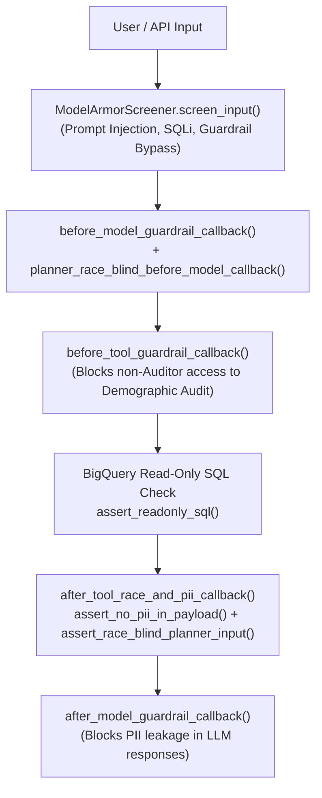

# `carebridge.security` — Race-Blind Guards, Model Armor & OWASP Callbacks (Plan 00)

The [`carebridge/security/`](file:///Users/dvt112/Downloads/A4I/carebridge/security/__init__.py) package enforces CareBridge Fulton's structural policy boundaries, PII redaction rules, prompt/SQL injection defenses, and OWASP LLM Top 10 callbacks across all agents and tools.

---

## Defense-in-Depth Security Architecture



---

## Modules & Guards

### 1. [`race_blind_guard.py`](file:///Users/dvt112/Downloads/A4I/carebridge/security/race_blind_guard.py)
Provides recursive structural inspection of dictionaries, lists, and prompt strings to guarantee zero PII leakage and zero demographic leakage into Track 1 (Evidence + Siting Planner):

- **[`PROHIBITED_PII_COLUMNS`](file:///Users/dvt112/Downloads/A4I/carebridge/security/race_blind_guard.py#L14-L24)**:
  Blocks HRSA administrative contact fields (`fqhc_admin_contact_nm`, `fqhc_admin_contact_email`, `fqhc_admin_contact_phone_num`, `bhcmis_admin_contact`, `site_admin_email`, `site_admin_phone`, `practitioner_full_name`).
- **[`PROHIBITED_PLANNER_DEMOGRAPHIC_KEYS`](file:///Users/dvt112/Downloads/A4I/carebridge/security/race_blind_guard.py#L28-L51)**:
  Blocks SVI Theme 3 and overall themes (`rpl_theme3`, `spl_theme3`, `ep_minrty`, `e_minrty`, `rpl_themes`, `spl_themes`) and race/ethnicity attributes (`pct_black`, `pct_hispanic`, `pct_asian`, `pct_white_non_hispanic`, `pct_minority`, `race_ethnicity_distribution`, `demographic_audit`, `external_demographic_audit`, `demographic_impact`).
- **[`assert_no_pii_in_payload(payload)`](file:///Users/dvt112/Downloads/A4I/carebridge/security/race_blind_guard.py#L79-L108)**:
  Recursively inspects keys and string values for prohibited PII column names, email addresses, and raw phone numbers; raises [`PolicyViolationError`](file:///Users/dvt112/Downloads/A4I/carebridge/security/race_blind_guard.py#L62-L64) on any match.
- **[`assert_race_blind_planner_input(payload)`](file:///Users/dvt112/Downloads/A4I/carebridge/security/race_blind_guard.py#L111-L143)**:
  Recursively inspects nested dicts, lists, and text prompts destined for Track 1 agents or tools; raises [`PolicyViolationError`](file:///Users/dvt112/Downloads/A4I/carebridge/security/race_blind_guard.py#L62-L64) if any demographic key or token appears.

### 2. [`model_armor.py`](file:///Users/dvt112/Downloads/A4I/carebridge/security/model_armor.py)
Implements input screening and Vertex AI Gemini safety settings:
- **[`ModelArmorScreener`](file:///Users/dvt112/Downloads/A4I/carebridge/security/model_armor.py#L31-L60)**:
  Screens incoming prompts via `screen_input(text)` against regex patterns for:
  - Prompt injection (`ignore all previous instructions`, `system prompt:`, `jailbreak`, `developer mode`)
  - SQL injection / DDL destruction (`DROP TABLE`, `' OR '1'='1`, `UNION SELECT`)
  - Equity guardrail bypass attempts (`bypass equity guardrail`, `use race to rank stops`)
- **[`default_vertex_safety_settings()`](file:///Users/dvt112/Downloads/A4I/carebridge/security/model_armor.py#L63-L80)**:
  Returns Vertex AI `SafetySetting` objects configured to `BLOCK_LOW_AND_ABOVE` across `HARM_CATEGORY_HATE_SPEECH`, `HARM_CATEGORY_HARASSMENT`, `HARM_CATEGORY_DANGEROUS_CONTENT`, and `HARM_CATEGORY_SEXUALLY_EXPLICIT`.

### 3. [`owasp_guardrails.py`](file:///Users/dvt112/Downloads/A4I/carebridge/security/owasp_guardrails.py)
Implements OWASP LLM Top 10 callbacks for Google ADK agents:
- **[`sanitize_user_prompt(prompt)`](file:///Users/dvt112/Downloads/A4I/carebridge/security/owasp_guardrails.py#L29-L41)** *(LLM01 Prompt Injection)*: Runs `ModelArmorScreener` and raises `PolicyViolationError` if blocked.
- **[`assert_readonly_sql(sql)`](file:///Users/dvt112/Downloads/A4I/carebridge/security/owasp_guardrails.py#L44-L59)** *(LLM02 / LLM07 Tool Safety)*: Verifies that SQL statements begin with `SELECT` or `WITH` and contain no mutating keywords (`INSERT`, `UPDATE`, `DELETE`, `DROP`, `ALTER`, `TRUNCATE`, `CREATE`, `GRANT`, `REVOKE`, `MERGE`, `EXECUTE`).
- **[`before_model_guardrail_callback(callback_context, llm_request)`](file:///Users/dvt112/Downloads/A4I/carebridge/security/owasp_guardrails.py#L62-L82)**: Screens prompts before LLM invocation and enforces `assert_race_blind_planner_input` when `agent_name` is in Track 1 (`health_access_agent`, `transit_community_agent`, `evidence_validator_agent`, `siting_planner_agent`).
- **[`after_model_guardrail_callback(callback_context, llm_response)`](file:///Users/dvt112/Downloads/A4I/carebridge/security/owasp_guardrails.py#L85-L95)**: Screens LLM outputs for accidental PII leakage.
- **[`before_tool_guardrail_callback(tool, args, tool_context)`](file:///Users/dvt112/Downloads/A4I/carebridge/security/owasp_guardrails.py#L98-L120)** *(LLM08 Excessive Agency)*: Enforces the protected tool boundary—only `equity_rigor_auditor` may invoke `mcp_query_posthoc_demographic_audit` or `execute_independent_plan_audit`. Also validates `county_fips` format (`^\d{5}$`).
- **[`after_tool_race_and_pii_callback(tool, args, tool_context, tool_response)`](file:///Users/dvt112/Downloads/A4I/carebridge/security/owasp_guardrails.py#L123-L141)**: Enforces `assert_no_pii_in_payload` on all tool outputs and `assert_race_blind_planner_input` on all Track 1 tool outputs.

---

## Verification

Tested in [`tests/test_00_contracts_and_security.py`](file:///Users/dvt112/Downloads/A4I/tests/test_00_contracts_and_security.py):
```bash
pytest tests/test_00_contracts_and_security.py -k "race_blind or pii or model_armor" -v
```
